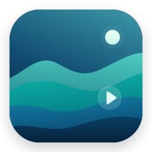
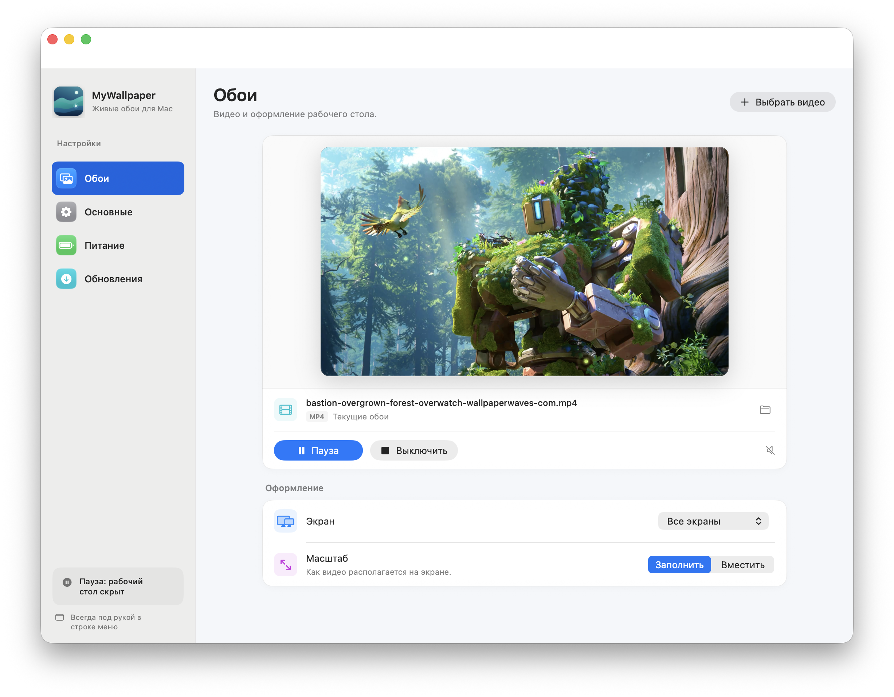
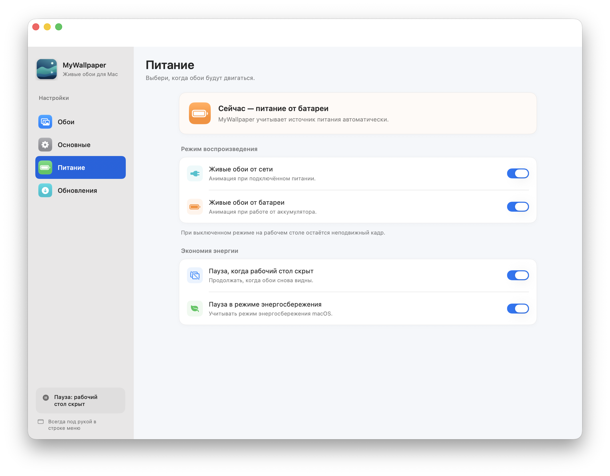

<div align="center">
  
  <h1>MyWallpaper</h1>
  <p><a href="README.md">Русский</a> | <strong>English</strong></p>
  <p><strong>Your favorite video, on your Mac desktop.</strong></p>
  <p>Live wallpapers without subscriptions or watermarks.<br>A native app built with Swift and SwiftUI.</p>
  <p><strong>macOS 13+</strong> · Apple Silicon and Intel · Light and dark appearance</p>
  <p>
    <a href="#installation">Installation</a> ·
    <a href="#features">Features</a> ·
    <a href="#getting-started">Getting started</a> ·
    <a href="#updates">Updates</a> ·
    <a href="#for-developers">For developers</a>
  </p>
</div>

<picture>
  <source media="(prefers-color-scheme: dark)" srcset="docs/images/wallpaper-dark.png">
  
</picture>

## Features

- **Your video on your desktop.** Local MP4, MOV, and other formats supported by macOS, playing in a continuous loop.
- **Battery-aware playback.** Animated on external power and still on battery by default. Both modes are configurable.
- **Smart pause.** Playback pauses separately on each display when windows cover the desktop.
- **Always within reach.** Menu bar controls, wallpaper restoration, and launch at login.
- **Multiple displays.** Use all displays or just the main one, with Fill or Fit scaling.
- **New versions nearby.** Check GitHub for updates, see an in-app notice, and download a DMG through your browser.

## Installation

**Requires macOS Ventura 13 or later and an Apple Silicon or Intel Mac.** The universal DMG includes both architectures; you do not need Xcode or Swift to install it.

1. Download the `.dmg` from [GitHub Releases](https://github.com/Illarioniche/MyWallpaper/releases).
2. Open the disk image and drag **MyWallpaper.app → Applications**.
3. Eject the disk image and open **MyWallpaper** from Applications.
4. Click **Choose Video** or drag an MP4/MOV into the app window.

> **Opening the app for the first time.** This build has a local ad-hoc signature and has not been notarized by Apple. If macOS cannot verify the developer or the app, first attempt to open it, then go to **System Settings → Privacy & Security → Open Anyway** and confirm if you trust the download source. [Apple's instructions](https://support.apple.com/102445).

## Getting started

1. In **Wallpaper**, choose a video, display, and scaling mode.
2. In **Power**, keep the default energy-saving settings or choose how playback behaves on external power and battery.
3. In **General**, optionally enable launch at login. Do this from the installed copy in Applications.
4. In **Updates**, check your app version and configure automatic update checks.

Under **General → App Language**, choose **System**, **Русский**, or **English**. Your choice is saved and takes effect immediately, without restarting the app. System mode uses the first supported language in your macOS preferred-language list, falling back to English if none match.

In **Audio**, adjust the volume from **0 to 100%**. **Mute** works independently: it temporarily silences the video while keeping your chosen volume. A volume of **0%** is also silent, even when Mute is off.

Closing the window keeps the wallpaper running in the menu bar. **Pause** preserves the current frame; **Turn Off** restores your regular macOS wallpaper.



## Updates

MyWallpaper checks the latest stable release in the public [GitHub repository](https://github.com/Illarioniche/MyWallpaper/releases/latest). Automatic checks are enabled by default: the app checks whether a request is due at startup and every hour while running, but sends an automatic request no more than once every 24 hours. You can disable this in **Updates**; the manual **Check for Updates** button remains available.

When a new version is found, a banner appears in the app and a badge appears on its menu bar icon. The app does not use system notifications or request notification permission. **Updates** provides the release page and, when published, links to the universal DMG and its SHA-256 file. Downloads open in your browser; the app does not download or install updates itself. If GitHub is unavailable or a check fails, your wallpaper keeps working and you can retry manually.

To update:

1. Download the DMG and quit MyWallpaper from its menu.
2. Open the disk image and drag **MyWallpaper.app** into **Applications**, confirming that you want to replace the previous version.
3. Eject the disk image and launch the app from **Applications**.

Replacing the app preserves your settings and selected video; the original video file is neither moved nor deleted. See [below](#building-a-dmg) for SHA-256 verification.

<details>
<summary><strong>I cannot see the menu bar icon</strong></summary>

If your macOS version has a Menu Bar settings section, check MyWallpaper's permission there. On a MacBook with a notch, the icon may be hidden because there is not enough space. While it is visible, hold **⌘ Command** and drag it closer to the clock, or make room among your other icons. Opening MyWallpaper again from Applications also brings back the control window.

</details>

<details>
<summary><strong>Launch at login will not turn on</strong></summary>

First quit MyWallpaper, move the app to **/Applications**, and open the installed copy. Do not enable launch at login for a copy running directly from a DMG. macOS may also run a downloaded app from a temporary isolated location, called App Translocation. The app shows installation guidance for this location and for read-only disks.

Return to **General** and try enabling launch at login again. The app refreshes its status from macOS: a missing registration does not prevent another attempt. If approval is required, open System Settings from the app. If registration still fails, go to **System Settings → General → Login Items & Extensions**, click **+** below **Open at Login**, and select the installed **MyWallpaper.app**. The section name may differ between macOS versions. [Apple's instructions](https://support.apple.com/en-hk/guide/mac-help/-mh15189/mac).

After adding the app manually, also enable **Restore Wallpaper at Launch** in MyWallpaper so your selected video returns when you log in.

Launch at login uses the system Service Management framework. This build is ad-hoc signed and not notarized; registration and launch at login cannot be guaranteed on every macOS version and configuration.

</details>

---

## For developers

There are no external dependencies. The following sections cover building, release packaging, validation, and how the app works.

### Building from source

You need Swift 6 or later and a compatible version of Xcode or Apple Command Line Tools. The macOS version required to build depends on your chosen tools; macOS 13 is the minimum for running the built app. To install Apple's tools and check the compiler version:

```sh
xcode-select --install
swift --version
```

From the project directory:

```sh
./scripts/build-app.sh
open dist/MyWallpaper.app
```

By default, the script builds for your Mac's architecture. To build a universal app:

```sh
./scripts/build-app.sh --universal
```

The script builds arm64 and x86_64 separately, combines them with `lipo`, adds icons, and signs the final `.app` with a local ad-hoc signature. A local build requires neither paid Apple Developer membership nor `sudo`. You can open the project in Xcode using `Package.swift`.

### Building a DMG

```sh
./scripts/build-dmg.sh
```

This command builds a universal app and creates a compressed disk image for drag-to-Applications installation:

```text
dist/
├── MyWallpaper.app
├── MyWallpaper-0.6.1-universal.dmg
└── MyWallpaper-0.6.1-universal.dmg.sha256
```

The image contains the app, a link to Applications, and brief installation instructions. The version comes from `Info.plist`; the architecture comes from the built executable. To package an existing build without recompiling:

```sh
./scripts/build-dmg.sh --skip-build
```

The filename reflects the actual architectures: `universal`, `arm64`, or `x86_64`. The script verifies the app signature, DMG integrity, and mounted image contents. Files in `dist/` are not tracked in Git: attach the `.dmg` and `.sha256` to a GitHub release. The scripts do not create tags or publish releases.

To verify a downloaded image, run this from the directory containing both files:

```sh
shasum -a 256 -c MyWallpaper-0.6.1-universal.dmg.sha256
```

The universal build includes Intel, but launch validation has been performed on Apple Silicon. Distribution with a verified developer identity separately requires Developer ID signing and Apple notarization.

### Icons and screenshots

The app, interface, and menu bar icons are drawn in `Sources/MyWallpaper/AppIconArtwork.swift`. The build generates a complete set of `.icns` sizes from the same artwork.

The screenshots in this README use the project's **Aurora** demo landscape, without user files. To reproduce them:

```sh
./scripts/render-readme.sh
```

The demo MP4 and intermediate images are saved in `.build/readme/`; the video is not included in the app or DMG. Rendering uses isolated settings, does not show windows, and does not enable wallpaper. After visually reviewing the output, update the documentation images:

```sh
./scripts/render-readme.sh --copy-images
```

### Detailed usage

1. Click **Choose Video** or drag an MP4/MOV into the app window.
2. Choose a section in the sidebar: **Wallpaper**, **General**, **Power**, or **Updates**. These contain video selection, display, and scaling; startup and audio settings; power behavior; and update checks and downloads.
3. Control playback from the window or menu bar icon. Closing the window leaves the wallpaper running.
4. Pause stops the video on its current frame. Turning the wallpaper off or quitting restores your regular desktop.

Video playback loops, and sound is muted by default. Video volume ranges from 0–100% independently of mute; both settings are saved. The app remembers the selected file and interface language. If the file is deleted or becomes unavailable, choose it again. Codec support depends on AVFoundation in your installed macOS version.

Playback pauses while the display is asleep or the session is inactive. Automatic pausing in Low Power Mode is also available in settings.

### Launch at login and energy use

In **Power**, **Animate on External Power** is enabled by default and **Animate on Battery** is disabled. A MacBook connected to power, including when its battery is fully charged, as well as a Mac mini or Mac Studio, uses the external-power setting. Switching to battery freezes the video on the current frame; connecting power resumes it. Both settings can be changed independently and are remembered across power changes and app launches.

The **Animate** button enables animation for the current power source. A manual pause persists when connecting or disconnecting power; sleep, a hidden desktop, and Low Power Mode remain separate reasons to pause. When starting in still mode, the first frame appears without briefly playing the video. If macOS does not report the power source, the saved external-power setting applies.

Quick settings in the menu bar stay synchronized with the main window. **Settings → Open Settings…** and `⌘,` open **General**.

Use **Settings → Launch at Login** to enable system-managed startup. Enabling it also turns on restoration of the selected video. After login, the app starts in the menu bar without opening its control window. A manual pause and **Turn Off Wallpaper** are remembered for the next launch.

If macOS requires approval, the app shows a pending state and a link to System Settings. It refreshes the status when you open the menu, so external changes are reflected too. Missing registration can be retried; an error never overrides the actual system status. For regular use, first move the `.app` to Applications, open that copy, and enable launch at login there. If registration fails, see **Launch at login will not turn on** above.

**Pause When the Desktop Is Hidden** is enabled by default. Each display is handled separately: wallpaper fully covered by windows freezes on its last frame and resumes when the desktop becomes visible. A 16-point macOS margin allows small edge gaps from rounded windows. When only some displays are hidden, the status shows the number still playing, for example **Playing on 1 of 2 displays**. When all selected displays are hidden, it shows **Paused: desktop is hidden**. Manual pause, sleep, and Low Power Mode take priority over automatic resuming. You can disable this setting from the same menu. Coverage uses window bounds, not per-pixel transparency, so a maximized translucent window can also trigger a pause.

### Validation

Swift Testing unit tests cover saved settings, language selection and translations, independent volume and mute controls, power sources and transitions, combinations of pause reasons, login management through a fake service, and update checks through a fake network transport. Tests do not modify real login items or device power settings, and update tests do not contact GitHub:

```sh
./scripts/test.sh
```

To test coverage with real macOS windows without loading a video or changing settings:

```sh
./scripts/test-coverage.sh --run
```

This briefly opens small test windows within a 360 × 240 area. It checks normal rounded windows, partial and combined coverage, a separate process, and stopping background checks. All test windows close automatically; other apps' windows are unchanged. Use `--build-only` to compile without running it.

The integration smoke test requires an active graphical macOS session and a local video path. It temporarily displays that video on the desktop, checks app behavior, then removes the test wallpaper. Its settings are isolated from the regular app.

```sh
./scripts/smoke-test.sh "/absolute/path/video.mp4"
```

The test checks video restoration after relaunch, manual pause, and desktop coverage with real test windows. It saves images of its own window to `.build/verification/empty.png` and `loaded.png`. Leave part of the desktop visible for visibility checks; the test does not close other apps' windows. To compile without opening windows, use `./scripts/smoke-test.sh --build-only`.

To check the interface without showing windows or enabling wallpaper:

```sh
./scripts/render-ui.sh "/absolute/path/video.mp4"
```

The optional video path is used only for a thumbnail. The script renders all four sections and the empty state in light and dark appearances, at normal and minimum window sizes. Update fixtures separately cover an available release, an in-progress check, an offline error, and an up-to-date app; the banner is saved separately as `ui-update-banner-wallpaper-*.png`. Standard README screenshots do not announce fictional releases. Additional fixtures cover login guidance for missing registration, a read-only disk, and a registration error. All GitHub responses and login services are fake: there are no real network requests or login-item changes. Images are saved as `.build/verification/ui-*.png`, with `-compact` for compact variants. Settings are isolated and no desktop screenshots are taken.

### How it works

Separate AppKit windows sit at desktop level below Finder icons and let mouse clicks pass through. On each display, an `AVQueuePlayer` with an `AVPlayerLooper` plays the video. The system wallpaper image stays unchanged: the app overlays its video while running.

Launch at login uses [SMAppService.mainApp](https://developer.apple.com/documentation/servicemanagement/smappservice). Visibility is tracked through [AppKit window occlusion notifications](https://developer.apple.com/documentation/appkit/nswindow/didchangeocclusionstatenotification), supplemented by checking window rectangles once a second. The additional check runs only when pause-on-hidden is enabled and animation is allowed. It reads window geometry; screen recording, window content access, and Accessibility permission are not required.

IOKit reports the power source through system notifications, without a timer. For startup in still mode, `AVAssetImageGenerator` extracts one frame and displays it until the video layer is ready. Pausing an already-playing video preserves its current frame.

`AppLocalizer` selects the Russian or English `Resources/*/Localizable.strings` catalog according to the app's language setting. Changing the language updates the interface and menus without changing macOS settings. Volume and mute are stored separately and applied to the video players; muting does not reset the chosen volume.

`UpdateController` requests the public GitHub API at `GET /repos/Illarioniche/MyWallpaper/releases/latest` and compares the installed app version with the latest stable release. Prereleases and drafts are not offered. The controller stores the automatic-check preference, the last attempt time for the daily interval, and the last successful check time. If a later check fails, a previously discovered update remains available. DMG, release-page, and SHA-256 links open in the browser. This mechanism does not install updates or modify app files.

The project is an MVP. The distributed DMG uses a local ad-hoc signature. Separate videos per display, a scene editor, and Developer ID signing/notarization are not yet implemented. Video wallpapers use CPU/GPU resources; energy use depends on resolution, frame rate, and the number of displays.
