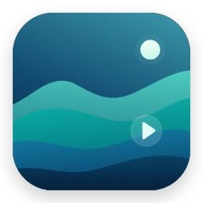
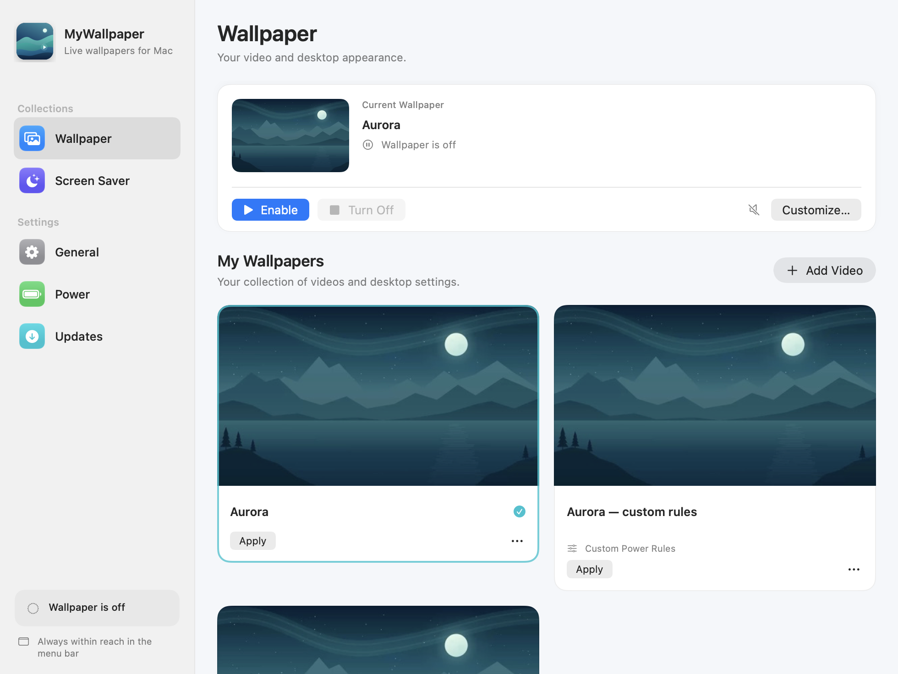
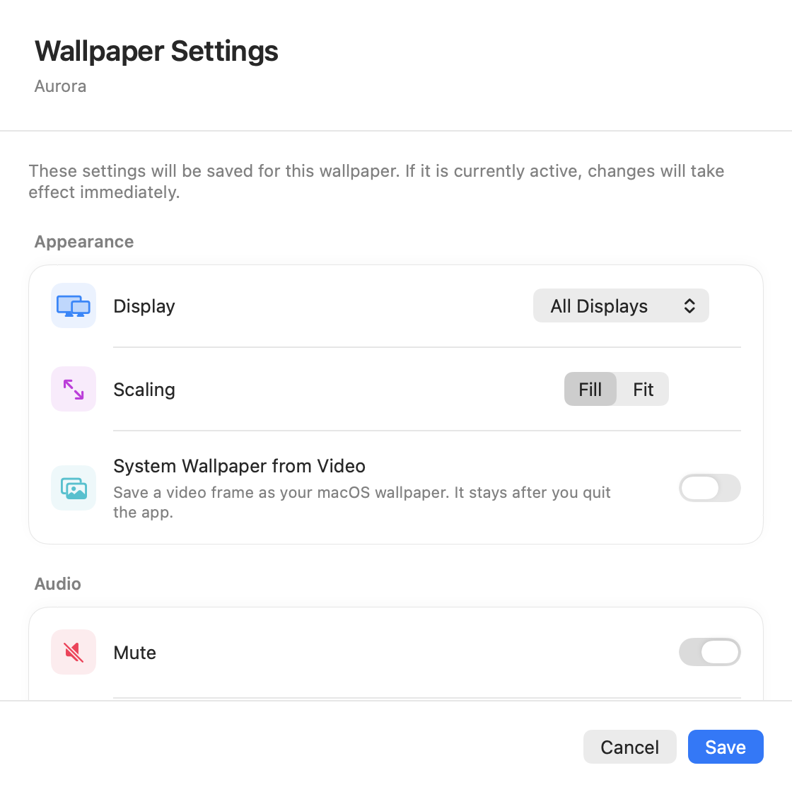
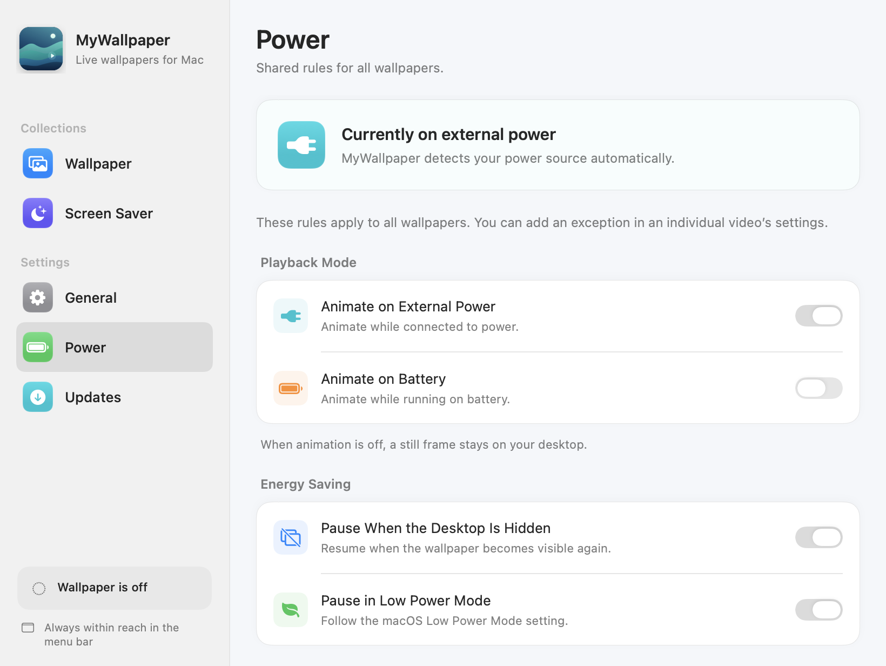
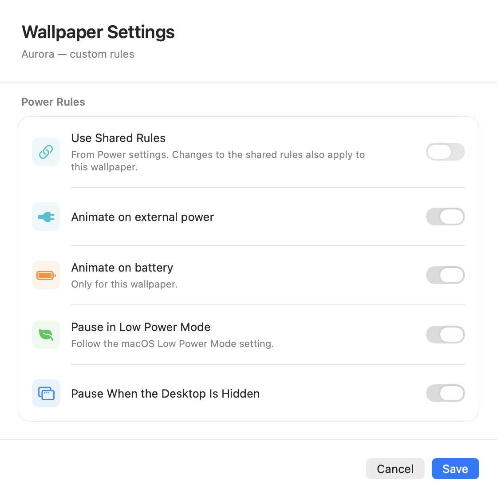
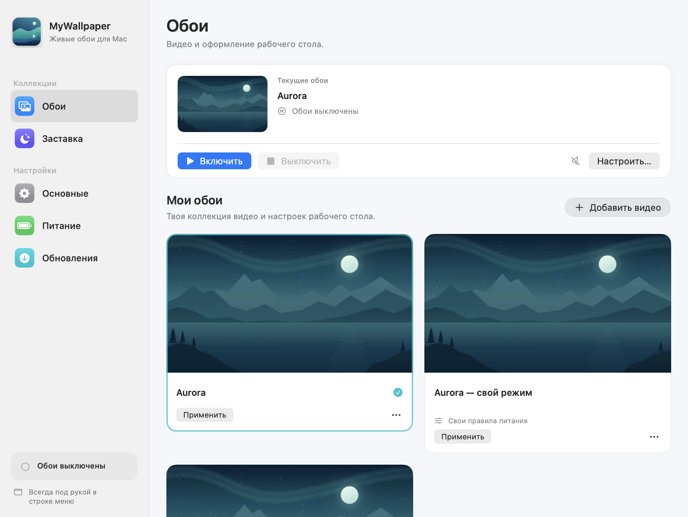
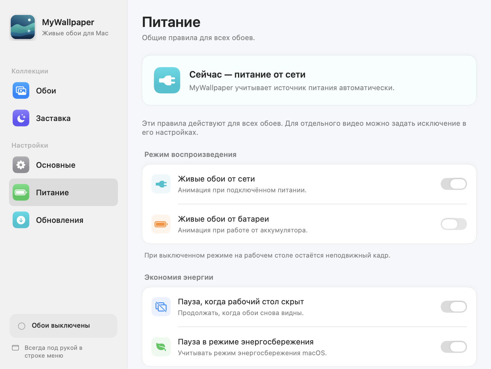
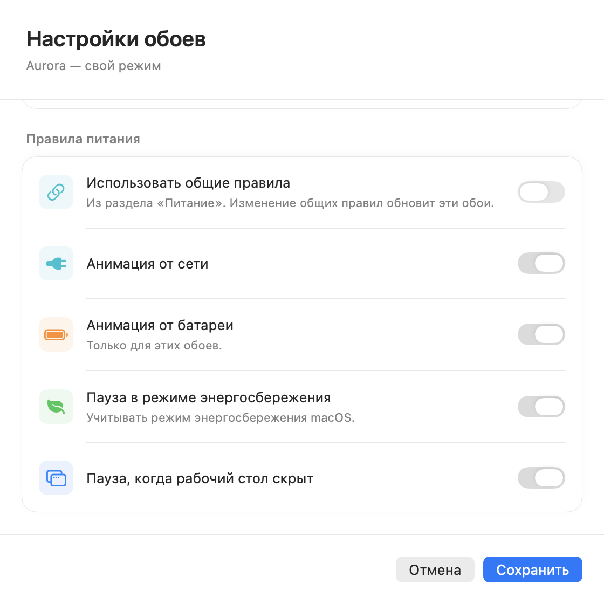

<a id="english"></a>

<div align="center">
  
  <h1>MyWallpaper</h1>
  <p><strong>English</strong> | <a href="#russian">Русский</a></p>
  <p><strong>Your favorite video, on your Mac desktop.</strong></p>
  <p>Live wallpapers without subscriptions or watermarks.<br>A native app built with Swift and SwiftUI.</p>
  <p><strong>macOS 13+</strong> · Apple Silicon and Intel · Light and dark appearance</p>
  <p>
    <a href="#installation">Installation</a> ·
    <a href="#features">Features</a> ·
    <a href="#getting-started">Getting started</a> ·
    <a href="#wallpaper-library">Wallpaper library</a> ·
    <a href="#video-screen-saver-experimental">Screen saver</a> ·
    <a href="#updates">Updates</a> ·
    <a href="#for-developers">For developers</a>
  </p>
</div>

<picture>
  <source media="(prefers-color-scheme: dark)" srcset="docs/images/wallpaper-en-dark.png">
  
</picture>

## Features

- **Your video on your desktop.** Local MP4, MOV, and other formats supported by macOS, playing in a continuous loop.
- **Wallpaper collection.** Cards with thumbnails, custom names, and saved settings: add videos, switch between them, rename, and delete.
- **Battery-aware playback.** Animated on external power and still on battery by default. Both modes are configurable.
- **Smart pause.** Playback pauses separately on each display when windows cover the desktop.
- **Always within reach.** Menu bar controls, wallpaper restoration, and launch at login.
- **Multiple displays.** Use all displays or just the main one, with Fill or Fit scaling.
- **System wallpaper from video.** Optionally save a frame as your regular macOS wallpaper; it stays after you stop the video or quit the app.
- **New versions nearby.** Update with one click: download, signature verification, restart, and What’s New.
- **Video screen saver library (Beta).** Save variants with meaningful names, rename or delete them, and choose which to install in macOS. Marked Beta while macOS compatibility is being verified.
- **Wallpaper and screen saver together.** Optionally synchronize the video, scaling, and power settings through a separate MyWallpaper — Sync screen saver.

## Installation

**Requires macOS Ventura 13 or later and an Apple Silicon or Intel Mac.** The universal DMG includes both architectures; you do not need Xcode or Swift to install it.

1. Download the `.dmg` from [GitHub Releases](https://github.com/Illarioniche/MyWallpaper/releases).
2. Open the disk image and drag **MyWallpaper.app → Applications**.
3. Eject the disk image and open **MyWallpaper** from Applications.
4. In **Wallpaper**, click **Add Video** or drag an MP4/MOV into the app window.

> **Opening the app for the first time.** This build has a local ad-hoc signature and has not been notarized by Apple. If macOS cannot verify the developer or the app, first attempt to open it, then go to **System Settings → Privacy & Security → Open Anyway** and confirm if you trust the download source. [Apple's instructions](https://support.apple.com/102445).

## Getting started

On first launch, **Quick Start** explains how to add a local video, the default power rules, and menu bar access. Dismiss it when ready; you can reopen it from **General**.

1. In **Wallpaper → My Wallpapers**, add a video and configure it using **⋯ → Customize** on its card.
2. In **Power**, keep the default energy-saving settings or choose how playback behaves on external power and battery.
3. In **General**, optionally enable launch at login. Do this from the installed copy in Applications.
4. In **Updates**, check your app version and configure automatic update checks.

New installations start in **English**, regardless of the macOS language. Previously saved **Русский**, **English**, or **System** choices are preserved on upgrade. Under **General → App Language**, choose **System**, **Русский**, or **English**. Your choice is saved and takes effect immediately, without restarting the app. System mode uses the first supported language in your macOS preferred-language list, falling back to English if none match.

In **Wallpaper → Customize → Audio**, adjust the volume from **0 to 100%**. **Mute** works independently: it temporarily silences the video while keeping your chosen volume. A volume of **0%** is also silent, even when Mute is off.

Under **Wallpaper → Customize → Appearance**, you can enable **System Wallpaper from Video**; it is off by default. The app saves a frame from the selected video as a still macOS wallpaper and updates it when you change the video, scaling, selected displays, or connected monitors. The frame applies to the current desktop on the selected displays; macOS may turn off Show on All Spaces when it is updated. You can turn that option back on manually in macOS Wallpaper settings if desired. Automatic application to every Space and display on the lock screen are not guaranteed. MyWallpaper continues to provide the animation. Turning this setting off stops future updates and leaves the last saved frame in place.

Closing the window keeps the wallpaper running in the menu bar. **Pause** preserves the current frame; **Turn Off** stops the video and reveals your regular macOS wallpaper. If you saved a system wallpaper frame from the video, that frame stays after you stop playback or quit the app.

Click the info icon next to the playback status at the bottom of the sidebar to see why the wallpaper is paused and what will resume it. The explanation follows the current state, including manual pause, battery rules, Low Power Mode, or windows covering the desktop.

If something is wrong, open **General → Help → Copy Diagnostics** and paste the report into a [GitHub issue](https://github.com/Illarioniche/MyWallpaper/issues). The report is in English for consistent bug reports and contains app/system versions and relevant playback settings. It omits video names and file paths. Copying only writes to your clipboard; nothing is sent automatically.

## Wallpaper library

The **Wallpaper** section contains **My Wallpapers**. Adding a video saves a separate copy and thumbnail in the app's library; there is no need to choose a folder or manage internal files. The original stays in place. Saved wallpapers remain available after restarting, even if you later move the original video.

- **Apply** activates a video with its saved settings. Its card indicates the currently selected wallpaper.
- **⋯ → Customize** opens that entry's display, scaling, mute and volume, animation on external power and battery, covered-desktop and Low Power Mode pauses, and system wallpaper sync settings. **Save** updates the entry and immediately applies changes if it is currently selected. Configuring another entry does not switch the current wallpaper.
- **⋯ → Rename** changes the card's name. **Delete** asks for confirmation, then removes the entry and its internal video copy. The original video is preserved. Deleting the selected wallpaper stops playback and prevents that entry from being restored at launch. Any previously saved system wallpaper frame remains.

The card, current wallpaper panel and menu bar open the same **Wallpaper Settings** editor. For the active wallpaper it shows the current values; for another video it shows its saved settings. **Save** stores changes, while **Cancel** keeps the existing settings. Quick mute commands also remember their state across app launches.

<picture>
  <source media="(prefers-color-scheme: dark)" srcset="docs/images/wallpaper-editor-en-dark.png">
  
</picture>

*Appearance, audio, and power for the selected wallpaper, in one editor.*

**Power** defines common rules for external power, battery, Low Power Mode and desktop coverage. New wallpapers follow these rules. To make an exception, turn off **Use Shared Rules** in that wallpaper’s editor and choose its own modes. Switching wallpapers never changes the common rules.

<picture>
  <source media="(prefers-color-scheme: dark)" srcset="docs/images/power-en-dark.png">
  
</picture>

*Set shared rules once in Power.*

<picture>
  <source media="(prefers-color-scheme: dark)" srcset="docs/images/wallpaper-power-exception-en-dark.png">
  
</picture>

*Give an individual video its own rules whenever needed.*

On upgrade, previous power preferences seed the common rules, while saved power settings in existing cards remain individual exceptions. Current settings of the active wallpaper that had not been saved to its card are also restored and can be saved through the unified editor. Original videos and saved presets are not automatically overwritten.

After an update, an existing wallpaper continues to work as before; the app does not copy it automatically. Choose **Save Current Wallpaper** to add it to the library with its current settings.

<a id="video-screen-saver-experimental"></a>

## Video screen saver (Beta)

Under **Screen Saver**, **My Screen Savers** lists your saved variants with thumbnails and names. The section above it can synchronize the screen saver with your wallpaper.

1. In **New Screen Saver**, enter a meaningful name and click **Choose Video**, or use **Use Current Wallpaper** to take the file already selected for your wallpaper.
2. Choose scaling and animation settings for external power and battery. These settings belong to the screen saver: by default, it animates on external power and shows a still frame on battery or in Low Power Mode.
3. Click **Save to Library**. The app stores the screen saver with a copy of its video; there is no need to choose a folder or manage files.
4. Find the variant you want in **My Screen Savers** and click **Install…**. Confirm installation in macOS. Different screen savers can be installed together; when reinstalling the same one, confirm replacement of its previous copy.
5. Click **Open Screen Saver Settings**, select your installed screen saver by name, and check its preview. In macOS 26 and later, open **Wallpaper → Screen Saver…** and choose **Custom** in the **Use Screen Saver** row. Scroll down **inside the dialog** to **Other** and click **Show All** if needed. In macOS 14–15, open **Screen Saver → Other** and expand the full list if needed; in macOS 13, find it in the thumbnail list under **Screen Saver**. [Apple's instructions](https://support.apple.com/en-om/guide/mac-help/mchl4b68853d/mac).

Use an entry's menu to rename or delete a saved variant. Deletion requires confirmation and removes only that library entry and its video copy. **The original video and any screen saver already installed in macOS are not deleted.** Renaming updates the library name immediately; reinstall that screen saver to update its name in macOS.

The installed screen saver runs independently of MyWallpaper; you can quit the app. It is **always muted**, regardless of the wallpaper volume. **Use Current Wallpaper** takes the selected video once; later wallpaper changes do not change saved screen savers. To use a different video or settings, save a new variant and install it from the library.

Existing library entries are preserved. To update one, click **Install…** again: the app prepares the screen saver using its saved video and the current version of the bundled player. There is no need to recreate the entry or select the original file again.

Discovery of two independently installed screen savers was verified on macOS 26.7.1: after reopening System Settings, the system catalog returned both entries with their user-defined names. Their presence in the system screen saver picker was also confirmed. **If the new screen saver does not appear, close and reopen System Settings.**

**This feature is in Beta.** The System Settings preview and behavior on the actual lock screen still need verification; behavior depends on the macOS version and its support for third-party screen savers. A message saying the installer opened does not confirm installation is complete: check your chosen screen saver in System Settings. Video behind the password field is not supported. The login screen and FileVault unlock screen are unchanged. You control installation and screen saver selection; the app does not change lock settings.

### Synchronize with wallpaper

1. Choose an **MP4 or MOV** wallpaper, then open **Screen Saver → Wallpaper and Screen Saver Together**.
2. Enable **Sync with Wallpaper**. The app prepares a separate copy of the selected video with its current scaling and power settings.
3. Click **Install MyWallpaper — Sync…** and confirm the macOS installer. Then select **MyWallpaper — Sync** in System Settings. In macOS 26, open **Wallpaper → Screen Saver… → Use Screen Saver → Custom → Other** and click **Show All** if needed.

Once installation is detected, setup collapses into a **Screen Saver Installed** status. The **⋯** menu keeps **Reinstall…**, a shortcut to System Settings, and the setup instructions. If you delete the screen saver from macOS, the install button returns when you switch back to the app. This status confirms installation; you still choose the active screen saver in System Settings.

Install and select this screen saver once. When you change the wallpaper, scaling, or power settings, MyWallpaper updates the saved data that the screen saver reads on its next start. Ordinary entries in **My Screen Savers** remain independent; selecting one of them in macOS does not automatically enable synchronization.

The screen saver is always muted. Manual wallpaper pause, desktop window coverage, and the main-display selection do not carry over: macOS controls which displays show the screen saver. Turning off sync, stopping wallpaper playback, quitting the app, or deleting the wallpaper library entry leaves the last saved video available to the screen saver. Synchronization is off by default.

**This mode is in Beta:** the linked screen saver's System Settings preview and behavior on the actual lock screen still need verification. Opening the installer does not confirm that macOS completed installation or selected the screen saver; you need to confirm those steps yourself.

## Updates

MyWallpaper checks the latest stable release in the public [GitHub repository](https://github.com/Illarioniche/MyWallpaper/releases/latest). Automatic checks are enabled by default: the app checks whether a request is due at startup and every hour while running, but sends an automatic request no more than once every 24 hours. You can disable this in **Updates**; the manual **Check for Updates** button remains available.

When a new version is found, a banner appears in the app and a badge appears on its menu bar icon. In **Updates**, click **Update** to download the signed GitHub release, follow its progress, finish pending collection saves, and restart. Wallpapers keep working until the restart. **Later** hides the reminder until the next manual check or launch; you can reopen the offer in Updates.

Collections, settings, selected wallpaper, and manual pause are preserved. An update restart restores the current session even when normal launch restoration is disabled; stopped wallpapers remain stopped. Temporary Animate Now is retained if the power source has not changed. The new version shows **What’s New**. Close it with the window’s close button or **Done**, and it will not open automatically again for that version. You can reopen it in Updates.

Downloads can be cancelled. Network or signature errors leave the current app running; retry, the release page, and manual DMG/SHA-256 downloads remain available. Installation always requires clicking Update.

**First upgrade:** versions before 0.10.0 do not include the built-in installer. Install 0.10.0 or later manually once: download the DMG, quit MyWallpaper, replace the app in **Applications**, and launch it from there. Subsequent releases with a signed `appcast.xml` can be installed inside the app. See [below](#building-a-dmg) for SHA-256 verification.

<details>
<summary><strong>I cannot see the menu bar icon</strong></summary>

If your macOS version has a Menu Bar settings section, check MyWallpaper's permission there. On a MacBook with a notch, the icon may be hidden because there is not enough space. While it is visible, hold **⌘ Command** and drag it closer to the clock, or make room among your other icons. Opening MyWallpaper again from Applications also brings back the control window.

</details>

<details>
<summary><strong>Launch at login will not turn on</strong></summary>

First quit MyWallpaper, move the app to **/Applications**, and open the installed copy. Do not enable launch at login for a copy running directly from a DMG. macOS may also run a downloaded app from a temporary isolated location, called App Translocation. The app shows installation guidance for this location and for read-only disks.

Return to **General** and try enabling launch at login again. The app refreshes its status from macOS: a missing registration does not prevent another attempt. If approval is required, open System Settings from the app. If registration still fails, go to **System Settings → General → Login Items & Extensions**, click **+** below **Open at Login**, and select the installed **MyWallpaper.app**. The section name may differ between macOS versions. [Apple's instructions](https://support.apple.com/en-hk/guide/mac-help/-mh15189/mac).

After adding the app manually, also enable **Restore Wallpaper at Launch** in MyWallpaper so your selected video returns when you log in.

Launch at login uses the system Service Management framework. This build is ad-hoc signed and not notarized; registration and launch at login cannot be guaranteed on every macOS version and configuration.

</details>

---

## For developers

Update installation uses [Sparkle 2.10.1](https://sparkle-project.org/) (MIT), pinned in Swift Package Manager. The first build needs internet access to download this dependency. The following sections cover building, release packaging, validation, and how the app works.

### Building from source

You need Swift 6 or later and a compatible version of Xcode or Apple Command Line Tools. The macOS version required to build depends on your chosen tools; macOS 13 is the minimum for running the built app. To install Apple's tools and check the compiler version:

```sh
xcode-select --install
swift --version
```

From the project directory:

```sh
./scripts/build-app.sh
open dist/MyWallpaper.app
```

By default, the script builds for your Mac's architecture. To build a universal app:

```sh
./scripts/build-app.sh --universal
```

The script builds arm64 and x86_64 separately, combines them with `lipo`, adds icons, and embeds the screen saver template in `Contents/PlugIns/MyWallpaper.saver`. The nested screen saver is signed first, then the final `.app` receives a local ad-hoc signature. A local build requires neither paid Apple Developer membership nor `sudo`. You can open the project in Xcode using `Package.swift`.

### Building the screen saver template

```sh
./scripts/build-screensaver.sh
./scripts/build-screensaver.sh --universal
```

The first command builds for your Mac's architecture; the second builds arm64 and x86_64. The result is `.build/MyWallpaper.saver`, a standalone Mach-O bundle with a `ScreenSaverView` from the [Screen Saver framework](https://developer.apple.com/documentation/screensaver). Its version comes from `Resources/Info.plist`; the build verifies its signature and architectures. The template contains no video and is intended for the app's exporter. Without exported resources, it shows a static background with guidance. The script does not install anything, open System Settings, or run the screen saver.

The app library is stored in `~/Library/Application Support/MyWallpaper/ScreenSavers`. Each entry has a UUID directory and its own metadata. Before installation, the app prepares a newly signed bundle using the saved resources and the current runtime. The UUID determines stable, unique bundle identifiers, class names, and installer filenames (`MyWallpaper-UUID.saver`); the user-facing name is written to `CFBundleName` and `CFBundleDisplayName`. Resources include standard `thumbnail.png` and `thumbnail@2x.png` previews for the system list. Preparing an installation does not alter the existing library entry. Deleting an entry frees its internal storage without affecting a separately installed system copy.

### Building a DMG

```sh
./scripts/build-dmg.sh
```

This command builds a universal app and creates a compressed disk image for drag-to-Applications installation:

```text
dist/
├── MyWallpaper.app
├── MyWallpaper-1.0.0-universal.dmg
└── MyWallpaper-1.0.0-universal.dmg.sha256
```

The image contains the app, a link to Applications, and brief installation instructions. The version comes from `Info.plist`; the architecture comes from the built executable. To package an existing build without recompiling:

```sh
./scripts/build-dmg.sh --skip-build
```

The filename reflects the actual architectures: `universal`, `arm64`, or `x86_64`. The script verifies the app signature, DMG integrity, and mounted image contents. Files in `dist/` are not tracked in Git: attach the `.dmg` and `.sha256` to a GitHub release. The scripts do not create tags or publish releases.

To verify a downloaded image, run this from the directory containing both files:

```sh
shasum -a 256 -c MyWallpaper-1.0.0-universal.dmg.sha256
```

The universal build includes Intel, but launch validation has been performed on Apple Silicon. Distribution with a verified developer identity separately requires Developer ID signing and Apple notarization.

### Signed updates

The update signing key lives in macOS Keychain under account `local.mywallpaper.MyWallpaper`; only its public key is embedded in the app. Configure it once on the release machine:

```sh
./scripts/setup-update-signing.sh
```

Keep a secure backup of the private key outside Git. Restore the same key on a different release machine: replacing it would break verification for existing users.

For each release, increase both `CFBundleShortVersionString` and the integer `CFBundleVersion` in `Resources/Info.plist`, add that version’s notes to `WhatsNewRelease.bundled` and both localization catalogs, then run:

```sh
./scripts/prepare-update.sh
# For an already-built universal app:
./scripts/prepare-update.sh --skip-build
```

The script verifies the universal app and DMG, creates SHA-256, and signs the archive and `dist/appcast.xml`. Attach the **DMG, `.dmg.sha256`, and `appcast.xml`** to the corresponding stable GitHub Release before publishing it. The feed is fetched from `releases/latest/download/appcast.xml`, so every subsequent stable release needs this asset. These scripts do not upload files or publish releases. Ed25519 update signatures are separate from Apple Developer ID signing and notarization.

Write GitHub release descriptions in English first, followed by the full Russian version. Keep installation instructions and limitations in both languages.

### Icons and screenshots

The app, interface, and menu bar icons are drawn in `Sources/MyWallpaper/AppIconArtwork.swift`. The build generates a complete set of `.icns` sizes from the same artwork.

Both language sections use the project's **Aurora** demo landscape, without user files. Light and dark screenshots of the collection, unified editor, shared power rules, and an individual exception are generated separately for the Russian and English interfaces. README images follow the reader’s theme automatically. To reproduce them:

```sh
./scripts/render-readme.sh
```

The demo MP4 and intermediate images are saved in `.build/readme/`; the video is not included in the app or DMG. Rendering uses isolated settings, does not show windows, and does not enable wallpaper. After visually reviewing the output, update the documentation images:

```sh
./scripts/render-readme.sh --copy-images
```

### Detailed usage

1. Click **Choose Video** or drag an MP4/MOV into the app window.
2. Choose a section in the sidebar: **Wallpaper**, **General**, **Power**, **Screen Saver**, or **Updates**. These contain the wallpaper library and unified editor; startup and language settings; common power rules; the system screen saver library; and update checks and downloads.
3. Control playback from the window or menu bar icon. Closing the window leaves the wallpaper running.
4. Pause stops the video on its current frame. Turning the wallpaper off or quitting restores your regular desktop.

Video playback loops, and sound is muted by default. Video volume ranges from 0–100% independently of mute; both settings are saved. The app remembers the selected file and interface language. If the file is deleted or becomes unavailable, choose it again. Codec support depends on AVFoundation in your installed macOS version.

Playback pauses while the display is asleep or the session is inactive. Automatic pausing in Low Power Mode is also available in settings.

### Launch at login and energy use

In **Power**, **Animate on External Power** is enabled by default and **Animate on Battery** is disabled. A MacBook connected to power, including when its battery is fully charged, as well as a Mac mini or Mac Studio, uses the external-power setting. Switching to battery freezes the video on the current frame; connecting power resumes it. Both settings can be changed independently and are remembered across power changes and app launches.

The **Animate Now** button temporarily enables animation until the power source changes, another wallpaper is selected, or playback is turned off. It does not change saved rules or the linked screen saver’s mode. A manual pause persists when connecting or disconnecting power; sleep, a hidden desktop, and Low Power Mode remain separate reasons to pause. When starting in still mode, the first frame appears without briefly playing the video. If macOS does not report the power source, the saved external-power setting applies.

The menu bar provides wallpaper status, playback, stop, mute, and shortcuts to the unified editor and app settings. **Open Settings…** and `⌘,` open **General**.

Use **General → Launch at Login** to enable system-managed startup. Enabling it also turns on restoration of the selected video. After login, the app starts in the menu bar without opening its control window. A manual pause and **Turn Off Wallpaper** are remembered for the next launch.

If macOS requires approval, the app shows a pending state and a link to System Settings. It refreshes the status when you open settings, so external changes are reflected too. Missing registration can be retried; an error never overrides the actual system status. For regular use, first move the `.app` to Applications, open that copy, and enable launch at login there. If registration fails, see **Launch at login will not turn on** above.

**Pause When the Desktop Is Hidden** is enabled by default. Each display is handled separately: wallpaper fully covered by windows freezes on its last frame and resumes when the desktop becomes visible. A 16-point macOS margin allows small edge gaps from rounded windows. When only some displays are hidden, the status shows the number still playing, for example **Playing on 1 of 2 displays**. When all selected displays are hidden, it shows **Paused: desktop is hidden**. Manual pause, sleep, and Low Power Mode take priority over automatic resuming. You can disable this setting in **Power** or in an individual wallpaper’s rules. Coverage uses window bounds, not per-pixel transparency, so a maximized translucent window can also trigger a pause.

### Validation

Swift Testing unit tests cover saved settings, language selection and translations, independent volume and mute controls, power sources and transitions, combinations of pause reasons, login management through a fake service, and update checks through a fake network transport. Tests do not modify real login items or device power settings, and update tests do not contact GitHub:

```sh
./scripts/test.sh
```

The feed generator and real Sparkle installer have separate checks:

```sh
python3 -B -m unittest discover -s Tests/Release -p 'test_*.py'
./scripts/sparkle-tools.sh
python3 scripts/test-update-installer.py
```

The integration test requires an active macOS session. It creates isolated fixture apps, an ephemeral signing key, and a loopback HTTP server to verify app replacement, relaunch, state preservation, and rejection of invalid archive/feed signatures. It does not modify the regular app, collections, or production signing key. Artifacts and logs are written to `.build/updater-probe`; the temporary private key is deleted afterwards.


To test coverage with real macOS windows without loading a video or changing settings:

```sh
./scripts/test-coverage.sh --run
```

This briefly opens small test windows within a 360 × 240 area. It checks normal rounded windows, partial and combined coverage, a separate process, and stopping background checks. All test windows close automatically; other apps' windows are unchanged. Use `--build-only` to compile without running it.

The integration smoke test requires an active graphical macOS session and a local video path. It temporarily displays that video on the desktop, checks app behavior, then removes the test wallpaper. Its settings are isolated from the regular app.

```sh
./scripts/smoke-test.sh "/absolute/path/video.mp4"
```

The test checks video restoration after relaunch, manual pause, and desktop coverage with real test windows. It saves images of its own window to `.build/verification/empty.png` and `loaded.png`. Leave part of the desktop visible for visibility checks; the test does not close other apps' windows. To compile without opening windows, use `./scripts/smoke-test.sh --build-only`.

A separate wallpaper library integration test checks import, applying saved entries with their settings, restoration, and deletion:

```sh
./scripts/test-wallpaper-library.sh "/path/to/video.mp4"
```

It requires a graphical macOS session and temporarily displays muted video in its own desktop test windows. Storage and preferences are isolated from the app; the system wallpaper, existing collections, and original video remain untouched. The test windows close after validation. To compile without running it, use `./scripts/test-wallpaper-library.sh --build-only`.

To check the linked screen saver in hidden test windows:

```sh
./scripts/build-screensaver.sh
./scripts/test-screensaver-sync.sh "/path/to/video.mp4"
```

This creates temporary media and an installer, switches videos and settings, checks recovery from unavailable data, and verifies compatibility with ordinary screen savers. It does not install a saver or lock macOS; it does not replace testing the System Settings preview.

To check the interface without showing windows or enabling wallpaper:

```sh
./scripts/render-ui.sh "/absolute/path/video.mp4"
```

The video path is optional. A supplied demo or local video is used for thumbnails and, when a built screen saver template is available, a temporary library with two entries in `.build/verification/ScreenSaverPreview-UUID`. The bundles receive a local ad-hoc signature through `codesign`; the temporary library is removed when rendering finishes. The script renders the app sections, screen saver list, empty library, and creation form in light and dark appearances, including compact variants. Update fixtures separately cover an available release, an in-progress check, an offline error, and an up-to-date app; the banner is saved separately as `ui-update-banner-wallpaper-*.png`. Standard README screenshots do not announce fictional releases. Additional fixtures cover login guidance for missing registration, a read-only disk, and a registration error. GitHub responses, login services, and the screen saver installer are fake: there are no real network requests, login-item changes, screen saver installations, or System Settings launches. Images are saved as `.build/verification/ui-*.png`, with `-compact` for compact variants. Settings are isolated and no desktop screenshots are taken.

### How it works

Separate AppKit windows sit at desktop level below Finder icons and let mouse clicks pass through. On each display, an `AVQueuePlayer` with an `AVPlayerLooper` plays the video. By default, the system wallpaper image stays unchanged while the app overlays its video. Enabling System Wallpaper from Video also saves a frame as the static macOS wallpaper using `NSWorkspace.setDesktopImageURL`; this frame remains after quitting MyWallpaper.

Launch at login uses [SMAppService.mainApp](https://developer.apple.com/documentation/servicemanagement/smappservice). Visibility is tracked through [AppKit window occlusion notifications](https://developer.apple.com/documentation/appkit/nswindow/didchangeocclusionstatenotification), supplemented by checking window rectangles once a second. The additional check runs only when pause-on-hidden is enabled and animation is allowed. It reads window geometry; screen recording, window content access, and Accessibility permission are not required.

IOKit reports the power source through system notifications, without a timer. For startup in still mode, `AVAssetImageGenerator` extracts one frame and displays it until the video layer is ready. Pausing an already-playing video preserves its current frame.

`AppLocalizer` selects the Russian or English `Resources/*/Localizable.strings` catalog according to the app's language setting. Changing the language updates the interface and menus without changing macOS settings. Volume and mute are stored separately and applied to the video players; muting does not reset the chosen volume.

`UpdateController` requests the public GitHub API at `GET /repos/Illarioniche/MyWallpaper/releases/latest` and compares the installed app version with the latest stable release. Prereleases and drafts are not offered. The controller stores the automatic-check preference, the last attempt time for the daily interval, and the last successful check time. If a later check fails, a previously discovered update remains available. After explicit consent, `UpdateInstallationController` starts Sparkle, requiring Ed25519 signatures on both the feed and DMG, a matching release version and download URL, and an increasing build number. Sparkle’s scheduler is disabled; `UpdateController` alone handles periodic checks. A one-use `UpdateRelaunchState` restores the session after a confirmed installation. `WhatsNewController` shows bundled localized notes matching the installed version and remembers dismissal.

MyWallpaper 1.0 is a stable release for live wallpapers; video screen savers and their synchronization remain Beta. The distributed DMG uses a local ad-hoc signature. Separate videos per display, a scene editor, and Developer ID signing/notarization are not yet implemented. Video wallpapers use CPU/GPU resources; energy use depends on resolution, frame rate, and the number of displays.

---

<a id="russian"></a>

<div align="center">
  
  <h1>MyWallpaper</h1>
  <p><a href="#english">English</a> | <strong>Русский</strong></p>
  <p><strong>Любимое видео — на рабочем столе Mac.</strong></p>
  <p>Живые обои без подписки и водяных знаков.<br>Нативное приложение на Swift и SwiftUI.</p>
  <p><strong>macOS 13+</strong> · Apple Silicon и Intel · Светлая и тёмная темы</p>
  <p>
    <a href="#установка">Установка</a> ·
    <a href="#возможности">Возможности</a> ·
    <a href="#первый-запуск">Первый запуск</a> ·
    <a href="#библиотека-обоев">Коллекция обоев</a> ·
    <a href="#видеозаставка-экспериментально">Заставка</a> ·
    <a href="#обновления">Обновления</a> ·
    <a href="#для-разработчиков">Для разработчиков</a>
  </p>
</div>

<picture>
  <source media="(prefers-color-scheme: dark)" srcset="docs/images/wallpaper-ru-dark.png">
  
</picture>

## Возможности

- **Твоё видео на рабочем столе.** Локальные MP4, MOV и другие форматы, поддерживаемые macOS, с непрерывным повтором.
- **Коллекция обоев.** Карточки с миниатюрами, своими названиями и сохранёнными настройками: добавляй видео, переключайся между вариантами, переименовывай и удаляй.
- **Забота о заряде.** По умолчанию от сети обои живые, от батареи — статичные. Оба режима настраиваются.
- **Умная пауза.** Если рабочий стол закрыт окнами, видео приостанавливается отдельно на каждом мониторе.
- **Всегда под рукой.** Управление из строки меню, восстановление выбранных обоев и автозапуск при входе.
- **Несколько экранов.** Обои на всех мониторах или только на основном; масштаб «Заполнить» или «Вместить».
- **Системный фон из видео.** По желанию сохраняй кадр как обычные обои macOS: он останется после остановки видео и выхода из приложения.
- **Новые версии рядом.** Обновление по кнопке: загрузка, проверка подписи, перезапуск и окно «Что нового?».
- **Библиотека видеозаставок (Beta).** Сохраняй варианты с понятными названиями, переименовывай, удаляй и выбирай заставку для установки в macOS. Помечена Beta: совместимость с macOS ещё проверяется.
- **Обои и заставка вместе.** По желанию синхронизируй видео, масштаб и режимы питания через отдельную заставку MyWallpaper — Sync.

## Установка

**Нужны macOS Ventura 13 или новее и Mac с Apple Silicon либо Intel.** Универсальный DMG содержит обе архитектуры; Xcode и Swift для установки не нужны.

1. Скачай `.dmg` из [GitHub Releases](https://github.com/Illarioniche/MyWallpaper/releases).
2. Открой образ и перетащи **MyWallpaper.app → Applications («Программы»)**.
3. Извлеки образ и запусти **MyWallpaper** из папки «Программы».
4. В разделе **«Обои»** нажми **«Добавить видео»** или перетащи MP4/MOV в окно приложения.

> **При первом открытии.** Текущая сборка имеет локальную ad-hoc подпись и ещё не прошла нотарификацию Apple. Если macOS не может проверить разработчика или приложение, после попытки запуска открой **Системные настройки → Конфиденциальность и безопасность → «Все равно открыть»** и подтверди запуск, если доверяешь источнику загрузки. [Инструкция Apple](https://support.apple.com/ru-ru/102445).

## Первый запуск

При первом запуске **«Быстрый старт»** объясняет, как добавить локальное видео, как работают режимы питания по умолчанию и где найти управление в строке меню. Подсказку можно закрыть и снова открыть в **«Основные»**.

1. В **«Обои → Мои обои»** добавь видео и настрой его через меню **«⋯ → Настроить»** на карточке.
2. В **«Питание»** оставь экономные настройки по умолчанию или выбери собственный режим для сети и батареи.
3. В **«Основные»** при желании включи запуск при входе в macOS. Делай это уже из установленной копии в «Программах».
4. В **«Обновления»** проверь версию приложения и настрой автоматическую проверку новых выпусков.

При новой установке используется **английский**, независимо от языка macOS. Ранее сохранённый выбор **Русский**, **English** или **Системный** сохраняется при обновлении. Переключить язык можно в **General → App Language**. В **«Основные → Язык приложения»** доступны **Системный**, **Русский** и **English**. Выбор сохраняется и применяется сразу, без перезапуска. Системный режим выбирает первый поддерживаемый язык из списка предпочитаемых языков macOS; если подходящего нет, используется английский.

В **«Обои → Настроить → Звук»** настрой громкость от **0 до 100%**. Переключатель **«Без звука»** работает независимо: он временно отключает звук, сохраняя выбранную громкость. Значение **0%** тоже даёт тишину, даже когда переключатель выключен.

В **«Обои → Настроить → Оформление»** можно включить **«Системный фон из видео»**; по умолчанию эта настройка выключена. Приложение сохраняет кадр выбранного видео как статичные обои macOS и обновляет его при смене видео, масштаба, выбранных экранов или состава подключённых мониторов. Кадр применяется к текущему рабочему столу на выбранных экранах; macOS при этом может выключить «Показывать на всех пространствах Spaces». При желании снова включи этот параметр вручную в системных настройках обоев. Автоматическое применение ко всем Spaces и отображение кадра на экране блокировки не гарантируются. Анимацию продолжает воспроизводить MyWallpaper. Выключение настройки прекращает последующие обновления и оставляет последний сохранённый кадр.

Закрытие окна не выключает обои — приложение остаётся в строке меню. **Пауза** сохраняет текущий кадр; **«Выключить»** останавливает видео и показывает обычные обои macOS. Если системный фон был сохранён из видео, этот кадр остаётся после остановки и выхода из приложения.

Нажми на значок информации рядом со статусом воспроизведения внизу боковой панели, чтобы узнать причину паузы и что возобновит видео. Объяснение соответствует текущему состоянию: ручная пауза, правила работы от батареи, режим энергосбережения или окна поверх рабочего стола.

Если что-то не работает, открой **«Основные → Скопировать диагностику»** и вставь отчёт в [обращение на GitHub](https://github.com/Illarioniche/MyWallpaper/issues). Отчёт составляется на английском для единообразия и содержит версии приложения и системы, а также относящиеся к воспроизведению настройки. Названия видео и пути к файлам в него не входят. Кнопка только копирует текст в буфер обмена, ничего не отправляя автоматически.

## Библиотека обоев

В разделе **«Обои»** находится коллекция **«Мои обои»**. При добавлении видео приложение сохраняет свою копию и миниатюру: выбирать папку или управлять внутренними файлами не нужно. Исходный файл остаётся на месте; сохранённые обои доступны после перезапуска, даже если оригинал позже перемещён.

- **«Применить»** включает выбранное видео вместе с сохранёнными настройками. Карточка показывает, какой вариант выбран сейчас.
- **«⋯ → Настроить»** открывает настройки этой записи: экран, масштаб, звук и громкость, анимация от сети и батареи, пауза при закрытом рабочем столе и энергосбережении, синхронизация системного фона. **«Сохранить»** обновляет запись; если она выбрана сейчас, изменения сразу применяются. Настройка другого варианта не переключает текущие обои.
- **«⋯ → Переименовать»** меняет название карточки. **«Удалить»** после подтверждения убирает запись и её внутреннюю копию видео. Исходное видео не удаляется. Если удалить выбранные обои, воспроизведение остановится и эта запись больше не будет восстанавливаться при запуске. Ранее сохранённый системный кадр останется.

У карточки, панели текущих обоев и команды в строке меню один редактор **«Настроить»**. Он показывает текущие значения активных обоев, а для другого видео — его сохранённые настройки. **«Сохранить»** записывает изменения; **«Отмена»** оставляет всё как было. Отключение звука через быстрые команды тоже запоминается между запусками приложения.

<picture>
  <source media="(prefers-color-scheme: dark)" srcset="docs/images/wallpaper-editor-ru-dark.png">
  
</picture>

*Оформление, звук и питание выбранных обоев — в одном редакторе.*

Раздел **«Питание»** задаёт общие правила: сеть, батарея, энергосбережение и пауза при скрытом рабочем столе. Новые обои следуют этим правилам. Чтобы задать исключение, в редакторе конкретных обоев выключи **«Использовать общие правила»** и выбери свои режимы. Переключение карточек не меняет общие правила.

<picture>
  <source media="(prefers-color-scheme: dark)" srcset="docs/images/power-ru-dark.png">
  
</picture>

*Общие правила задаются один раз в разделе «Питание».*

<picture>
  <source media="(prefers-color-scheme: dark)" srcset="docs/images/wallpaper-power-exception-ru-dark.png">
  
</picture>

*При необходимости у конкретного видео могут быть свои правила.*

При обновлении прежние настройки питания становятся общими правилами, а сохранённые режимы существующих карточек остаются индивидуальными исключениями. Текущие настройки активных обоев, которые раньше не были записаны в карточку, также восстанавливаются: их можно сохранить через единый редактор. Исходные видео и сохранённые варианты не перезаписываются автоматически.

После обновления ранее выбранное видео продолжает работать как раньше: приложение не копирует его автоматически. Нажми **«Сохранить текущие обои»**, чтобы добавить его в коллекцию вместе с текущими настройками.

<a id="видеозаставка-экспериментально"></a>

## Видеозаставка (Beta)

В разделе **«Заставка»** находится библиотека **«Мои заставки»**: сохранённые варианты с миниатюрами и названиями. Над ней можно включить синхронизацию с обоями.

1. В форме **«Новая заставка»** задай понятное название и нажми **«Выбрать видео»** или **«Из текущих обоев»**, чтобы взять уже выбранный файл.
2. Выбери масштаб и режимы анимации для сети и батареи. Это отдельные настройки заставки: по умолчанию от сети видео движется, на батарее и в режиме энергосбережения показывается неподвижный кадр.
3. Нажми **«Сохранить в библиотеку»**. Приложение само сохранит заставку вместе с копией видео — выбирать папку или управлять файлами не нужно.
4. Найди нужный вариант в **«Мои заставки»** и нажми **«Установить…»**. Подтверди установку в macOS. Разные заставки можно установить одновременно; при переустановке той же заставки подтверди замену её предыдущей копии.
5. Нажми **«Открыть настройки заставки»**, выбери установленную заставку по её названию и проверь предпросмотр. В macOS 26 и новее открой **«Обои» → «Заставка…»** и выбери **«Настроить»** в строке **«Использовать заставку»**. Прокрути список **внутри диалога** вниз до раздела **«Другое»** и при необходимости нажми **«Показать все»**. В macOS 14–15 открой **«Заставка» → «Другое»** и при необходимости разверни весь список; в macOS 13 найди заставку в списке миниатюр раздела **«Заставка»**. [Инструкция Apple](https://support.apple.com/guide/mac-help/mchl4b68853d/mac).

Через меню записи можно переименовать или удалить сохранённый вариант. Удаление требует подтверждения и убирает только запись библиотеки с её копией видео. **Исходное видео и уже установленная в macOS заставка не удаляются.** Переименование сразу меняет название в библиотеке; чтобы обновить его в macOS, установи эту заставку ещё раз.

Установленная заставка работает независимо от MyWallpaper: приложение можно закрыть. Она **всегда без звука**, независимо от громкости видеообоев. Кнопка **«Из текущих обоев»** берёт выбранное видео один раз; дальнейшие изменения обоев не меняют сохранённые заставки. Чтобы использовать другое видео или настройки, сохрани новый вариант и установи его из библиотеки.

Ранее созданные записи библиотеки сохраняются. Для их обновления достаточно снова нажать **«Установить…»**: приложение подготовит заставку из сохранённого видео и текущей версии встроенного проигрывателя. Заново создавать запись или выбирать исходный файл не нужно.

На macOS 26.7.1 проверено обнаружение двух независимо установленных заставок: после повторного открытия системных настроек системный каталог вернул обе записи с их пользовательскими названиями. Их наличие в системном выборе заставки также подтверждено. **Если новая заставка не появилась, закрой и снова открой системные настройки.**

**Функция в статусе Beta.** Предпросмотр в системных настройках и работа на настоящем экране блокировки ещё требуют проверки; поведение зависит от версии macOS и её поддержки сторонних заставок. Сообщение об открытии установки не подтверждает её завершение: проверь выбранную заставку в системных настройках. Показ видео за полем ввода пароля не поддерживается. Экран входа и экран разблокировки FileVault не изменяются. Установка и выбор заставки остаются за пользователем; параметры блокировки приложение не меняет.

### Синхронизация с обоями

1. Выбери обои из видео **MP4 или MOV** и открой **«Заставка → Обои и заставка вместе»**.
2. Включи **«Синхронизировать с обоями»**. Приложение подготовит отдельную копию выбранного видео с текущим масштабом и режимами питания.
3. Нажми **«Установить MyWallpaper — Sync…»** и подтверди установку в macOS. Затем выбери **MyWallpaper — Sync** в системных настройках заставки. В macOS 26 путь: **«Обои → Заставка… → Использовать заставку → Настроить → Другое»**; при необходимости нажми **«Показать все»**.

После подтверждённой установки блок настройки сворачивается в статус **«Заставка установлена»**. В меню **⋯** остаются **«Переустановить…»**, переход к настройкам macOS и инструкция. Если удалить заставку из macOS, при возвращении в приложение снова появится кнопка установки. Статус подтверждает наличие заставки, а выбрать её для показа нужно в системных настройках.

Достаточно установить и выбрать эту заставку один раз. После смены обоев, масштаба или режимов питания MyWallpaper обновит сохранённые данные, которые заставка прочитает при следующем запуске. Обычные варианты из **«Мои заставки»** остаются независимыми; выбор одного из них в macOS не включает синхронизацию автоматически.

Заставка всегда без звука. Ручная пауза обоев, перекрытие рабочего стола окнами и выбор основного монитора не переносятся на неё: экранами заставки управляет macOS. Выключение синхронизации, остановка обоев, выход из приложения и удаление обоев из библиотеки оставляют последнее сохранённое видео доступным для заставки. Синхронизация по умолчанию выключена.

**Режим в статусе Beta:** работа связанной заставки в предпросмотре системных настроек и на экране блокировки ещё требует проверки. Открытый диалог установки не означает, что macOS завершила установку или выбрала заставку; эти шаги нужно подтвердить самостоятельно.

## Обновления

MyWallpaper проверяет последний стабильный выпуск в публичном [репозитории GitHub](https://github.com/Illarioniche/MyWallpaper/releases/latest). Автоматическая проверка включена по умолчанию: приложение проверяет, пора ли обратиться к GitHub, при запуске и раз в час во время работы, а сам запрос выполняет не чаще раза в 24 часа. Её можно отключить в разделе **«Обновления»**; ручная кнопка **«Проверить обновления»** остаётся доступна.

Когда найдена новая версия, в приложении появляется баннер, а у значка в строке меню — отметка. В разделе **«Обновления»** нажми **«Обновить»**: приложение скачает подписанный выпуск с GitHub, покажет прогресс, дождётся сохранения коллекции и перезапустится. До перезапуска обои продолжают работать. **«Позже»** убирает напоминание до следующей ручной проверки или запуска; открыть предложение снова можно в том же разделе.

Коллекции, настройки, выбранные обои и ручная пауза сохраняются. После обновления восстанавливается текущий сеанс, даже если обычное восстановление при запуске отключено; выключенные обои остаются выключенными. Временное «Оживить сейчас» сохраняется, если источник питания не изменился. Новая версия показывает **«Что нового?»**: закрой окно крестиком или кнопкой **«Готово»**, и оно больше не появится автоматически для этой версии. Его можно снова открыть в разделе «Обновления».

Загрузку можно отменить. При ошибке сети или подписи текущая версия продолжает работать; доступны повторная попытка, страница релиза и ручная загрузка DMG с SHA-256. Обновления никогда не устанавливаются без нажатия «Обновить».

**Первый переход:** версии до 0.10.0 не содержат встроенного установщика. Один раз установи 0.10.0 или новее вручную: скачай DMG, заверши MyWallpaper, перетащи приложение в **Applications** с заменой и запусти его оттуда. Следующие выпуски со связанным подписанным `appcast.xml` будут доступны для установки внутри приложения. Проверка SHA-256 описана [ниже](#сборка-dmg).

<details>
<summary><strong>Не вижу значок в строке меню</strong></summary>

Если в твоей версии macOS есть раздел «Строка меню», проверь в нём разрешение для MyWallpaper. На MacBook с вырезом значок может скрыться из-за нехватки места: удерживая **⌘ Command**, перетащи его ближе к часам, пока он виден, либо освободи место среди других значков. Повторное открытие MyWallpaper из «Программ» также возвращает окно управления.

</details>

<details>
<summary><strong>Не включается запуск при входе</strong></summary>

Сначала заверши MyWallpaper, перенеси приложение в **/Applications («Программы»)** и открой установленную копию. Не включай автозапуск у копии, запущенной прямо из DMG. macOS также может запускать скачанное приложение из временного изолированного расположения — App Translocation; для него и для диска только для чтения приложение показывает подсказку по установке.

Вернись в **«Основные»** и повтори включение автозапуска. Состояние повторно считывается из macOS: отсутствие регистрации само по себе не блокирует новую попытку. Если требуется подтверждение, открой системные настройки из приложения. Если регистрация по-прежнему не удаётся, перейди в **Системные настройки → Основные → Объекты входа и расширения**, нажми **«+»** под списком **«Открывать при входе»** и выбери установленный **MyWallpaper.app**. Название раздела может различаться в разных версиях macOS. [Инструкция Apple](https://support.apple.com/en-hk/guide/mac-help/-mh15189/mac).

После ручного добавления также включи **«Восстанавливать обои при запуске»** в MyWallpaper, чтобы при входе возвращалось выбранное видео.

Автозапуск использует системный Service Management. Текущая сборка подписана ad-hoc и не нотарифицирована; её регистрацию и запуск при входе нельзя гарантировать на каждой версии и конфигурации macOS.

</details>

---

## Для разработчиков

Для установки обновлений используется [Sparkle 2.10.1](https://sparkle-project.org/) (MIT), закреплённый в Swift Package Manager. При первой сборке нужен интернет для загрузки зависимости. Ниже — сборка, упаковка релиза, проверки и детали работы приложения.

### Сборка из исходников

Для сборки нужны Swift 6 или новее и совместимая версия Xcode либо Apple Command Line Tools. Требования к macOS зависят от выбранных инструментов; macOS 13 — минимум для запуска готового приложения. Установить инструменты Apple и проверить версию компилятора:

```sh
xcode-select --install
swift --version
```

В папке проекта:

```sh
./scripts/build-app.sh
open dist/MyWallpaper.app
```

По умолчанию собирается архитектура текущего Mac. Для универсального приложения:

```sh
./scripts/build-app.sh --universal
```

Скрипт собирает arm64 и x86_64 отдельно, объединяет их через `lipo`, добавляет иконки и шаблон заставки в `Contents/PlugIns/MyWallpaper.saver`. Вложенная заставка подписывается первой, затем итоговый `.app` получает локальную ad-hoc подпись. Для локальной сборки не нужны платная учётная запись Apple Developer и `sudo`. Проект можно открыть в Xcode через `Package.swift`.

### Сборка шаблона заставки

```sh
./scripts/build-screensaver.sh
./scripts/build-screensaver.sh --universal
```

Первая команда собирает архитектуру текущего Mac, вторая — arm64 и x86_64. Результат — `.build/MyWallpaper.saver`, самостоятельный Mach-O bundle с `ScreenSaverView` из [Screen Saver framework](https://developer.apple.com/documentation/screensaver). Версия берётся из `Resources/Info.plist`; подпись и архитектуры проверяются при сборке. Шаблон не содержит видео и предназначен для экспорта из приложения: без добавленных ресурсов он показывает статичный фон с подсказкой. Скрипт ничего не устанавливает, не открывает системные настройки и не запускает заставку.

Библиотека приложения хранится в `~/Library/Application Support/MyWallpaper/ScreenSavers`. Каждой записи соответствует каталог с UUID и собственными метаданными. Перед установкой приложение готовит новый подписанный пакет из сохранённых ресурсов и текущего runtime. UUID задаёт стабильные уникальные bundle identifier, имя класса и имя установочного файла `MyWallpaper-UUID.saver`, а пользовательское название записывается в `CFBundleName` и `CFBundleDisplayName`. Ресурсы включают стандартные `thumbnail.png` и `thumbnail@2x.png` для системного списка. Существующая запись библиотеки при подготовке установки не изменяется. Удаление записи освобождает её внутреннее хранилище, не затрагивая отдельно установленную системную копию.

### Сборка DMG

```sh
./scripts/build-dmg.sh
```

Команда собирает универсальное приложение и создаёт сжатый образ для установки перетаскиванием:

```text
dist/
├── MyWallpaper.app
├── MyWallpaper-1.0.0-universal.dmg
└── MyWallpaper-1.0.0-universal.dmg.sha256
```

Внутри образа находятся приложение, ссылка на папку «Программы» и краткая инструкция. Версия берётся из `Info.plist`, архитектура — из готового исполняемого файла. Для упаковки уже собранного приложения без повторной компиляции:

```sh
./scripts/build-dmg.sh --skip-build
```

Имя такого образа отражает реальные архитектуры: `universal`, `arm64` или `x86_64`. Скрипт проверяет подпись приложения, целостность DMG и содержимое смонтированного образа. Файлы из `dist/` не добавляются в Git: для релиза приложи `.dmg` и `.sha256` к версии в GitHub Releases. Скрипты сами не создают тег и не публикуют релиз.

Проверка скачанного образа из каталога с обоими файлами:

```sh
shasum -a 256 -c MyWallpaper-1.0.0-universal.dmg.sha256
```

Universal-сборка включает Intel, но текущая проверка запуска выполнялась на Apple Silicon. Для распространения с подтверждённым разработчиком отдельно потребуются Developer ID и нотарификация Apple.

### Подписанные обновления

Ключ обновлений хранится в macOS Keychain, аккаунт `local.mywallpaper.MyWallpaper`; в приложение входит только открытый ключ. На машине выпуска настрой его один раз:

```sh
./scripts/setup-update-signing.sh
```

Храни резервную копию закрытого ключа отдельно и безопасно; не добавляй её в Git. На другой машине нужно восстановить тот же ключ: его замена нарушит проверку обновлений у существующих пользователей.

Для каждого выпуска увеличь `CFBundleShortVersionString` и целочисленный `CFBundleVersion` в `Resources/Info.plist`, добавь заметки этой версии в `WhatsNewRelease.bundled` и оба каталога переводов. Затем:

```sh
./scripts/prepare-update.sh
# Для уже собранного universal приложения:
./scripts/prepare-update.sh --skip-build
```

Скрипт проверяет universal-приложение и DMG, создаёт SHA-256, подписывает архив и `dist/appcast.xml`. Прикрепи **DMG, `.dmg.sha256` и `appcast.xml`** к соответствующему стабильному GitHub Release и только затем публикуй его. Лента читается по `releases/latest/download/appcast.xml`, поэтому она нужна в каждом следующем стабильном выпуске. Скрипты не публикуют файлы и не создают релизы. Подпись обновлений Ed25519 отдельна от Apple Developer ID и notarization.

Описание релиза на GitHub начинай с английской версии, сразу после неё добавляй полную русскую. Инструкции по установке и ограничения должны быть в обоих языках.

### Иконки и скриншоты

Иконки приложения, интерфейса и строки меню рисуются в `Sources/MyWallpaper/AppIconArtwork.swift`. Сборка создаёт полный набор размеров `.icns` из того же рисунка.

Скриншоты в обеих языковых частях README используют собственный демонстрационный пейзаж **Aurora**, без пользовательских файлов. Для русского и английского интерфейса создаются светлые и тёмные варианты коллекции, единого редактора, общих правил питания и индивидуального исключения. Тема изображений в README выбирается автоматически. Их можно воспроизвести:

```sh
./scripts/render-readme.sh
```

Демонстрационный MP4 и промежуточные изображения сохраняются в `.build/readme/`; видео не входит в приложение или DMG. Рендер использует изолированные настройки, не показывает окна и не включает обои. После визуальной проверки обнови изображения в документации:

```sh
./scripts/render-readme.sh --copy-images
```

### Подробное использование

1. Нажмите «Выбрать видео» или перетащите MP4/MOV в окно приложения.
2. В основном окне выберите раздел слева: **Обои**, **Основные**, **Питание**, **Заставка** или **Обновления**. Здесь находятся коллекция и единый редактор обоев; автозапуск и язык; общие правила питания; библиотека системных заставок; проверка и загрузка новых версий.
3. Управляйте воспроизведением через окно или значок в строке меню. Закрытие окна оставляет обои включёнными.
4. Пауза останавливает видео на текущем кадре. Остановка обоев или выход возвращает обычный рабочий стол.

Видео зацикливается; звук по умолчанию выключен. Громкость видео настраивается в диапазоне 0–100% отдельно от отключения звука; обе настройки сохраняются. Приложение запоминает выбранный файл и язык интерфейса. Если файл удалён или стал недоступен, его потребуется выбрать снова. Поддержка конкретного кодека определяется AVFoundation в установленной macOS.

При сне экрана и неактивном сеансе воспроизведение приостанавливается. В настройках доступна автоматическая пауза в режиме энергосбережения.

### Автозапуск и экономия энергии

В **Питание** по умолчанию включены **Живые обои от сети** и выключены **Живые обои от батареи**. MacBook с подключённым блоком питания (в том числе при полностью заряженной батарее), Mac mini и Mac Studio используют настройку питания от сети. При переходе на батарею видео замирает на текущем кадре, при подключении питания — продолжается. Обе настройки можно менять независимо; выбор запоминается и действует при следующих переключениях и запусках.

Кнопка **Оживить сейчас** временно разрешает анимацию: до смены источника питания, выбора других обоев или выключения. Она не изменяет сохранённые правила и режим связанной заставки. Ручная пауза сохраняется при подключении и отключении зарядки, а сон, скрытый рабочий стол и системное энергосбережение остаются отдельными причинами приостановки. При запуске сразу в статичном режиме показывается первый кадр выбранного видео, без кратковременного воспроизведения. Если macOS не сообщила источник питания, применяется сохранённая настройка для сети.

В строке меню доступны состояние обоев, воспроизведение, выключение, отключение звука и переходы к единому редактору и настройкам приложения. Команда **Открыть настройки…** и `⌘,` открывают раздел **Основные**.

В разделе **Основные → Запускать при входе в macOS** можно включить системный автозапуск. При включении также активируется восстановление выбранного видео. После входа приложение запускается в строке меню, без открытия панели управления. Ручная пауза и команда «Выключить обои» сохраняются при следующем запуске.

Если macOS ожидает подтверждения, рядом с автозапуском отображается промежуточное состояние и переход в системные настройки. Состояние перечитывается из системы при открытии настроек, поэтому внешние изменения тоже учитываются. Отсутствующую регистрацию можно создать повторной попыткой; ошибка не заменяет фактический статус системы. Для постоянного использования сначала перенесите `.app` в «Программы», откройте эту копию и включите автозапуск в ней. Если регистрация не удаётся, используйте инструкцию **«Не включается запуск при входе»** выше.

**Пауза, когда рабочий стол скрыт** включена по умолчанию. Она действует отдельно для каждого монитора: полностью закрытые окнами обои замирают на последнем кадре, а при появлении рабочего стола продолжаются. Небольшие зазоры по краям экрана учитываются с допуском 16 пунктов macOS, чтобы скругления окон не мешали паузе. Если скрыта только часть мониторов, статус показывает число воспроизводящих экранов, например **Воспроизведение: 1 из 2 экранов**. Когда скрыты все выбранные экраны, отображается **Пауза: рабочий стол скрыт**. Ручная пауза, сон и режим энергосбережения имеют приоритет над автоматическим возобновлением. Настройку можно отключить в разделе **Питание** или в индивидуальных правилах обоев. Проверяются границы окон, а не прозрачность каждого пикселя: развёрнутое полупрозрачное окно тоже может включить паузу.

### Проверки

Модульные тесты на Swift Testing проверяют сохранение настроек, выбор языка и перевод строк, независимость громкости и отключения звука, источники питания и их переключения, сочетания причин паузы, управление автозапуском через подставной сервис и проверку обновлений через подставной сетевой транспорт. Реальные системные элементы входа и питание устройства тестами не изменяются; тесты обновлений не обращаются к GitHub:

```sh
./scripts/test.sh
```

Отдельно проверяются генерация ленты и настоящий установщик Sparkle:

```sh
python3 -B -m unittest discover -s Tests/Release -p 'test_*.py'
./scripts/sparkle-tools.sh
python3 scripts/test-update-installer.py
```

Интеграционная проверка требует активного сеанса macOS. Она создаёт отдельные тестовые приложения, временный ключ подписи и локальный HTTP-сервер; проверяет замену версии с перезапуском, сохранение состояния и отклонение неверных подписей архива и ленты. Рабочее приложение, коллекции и ключ релизов не изменяются. Артефакты и журнал — в `.build/updater-probe`; временный закрытый ключ удаляется после проверки.


Проверка перекрытия настоящими окнами macOS без загрузки видео и изменения настроек:

```sh
./scripts/test-coverage.sh --run
```

Она на несколько секунд открывает небольшие тестовые окна в области 360 × 240, проверяет обычные окна со скруглениями, частичное и совместное перекрытие, отдельный процесс и остановку фоновых проверок. Все тестовые окна закрываются автоматически; окна других приложений не меняются. `--build-only` только компилирует проверку.

Интеграционная проверка требует открытого графического сеанса macOS и пути к локальному видео. Она временно показывает его на рабочем столе, проверяет работу приложения и затем убирает тестовые обои. Настройки проверки изолированы от обычного приложения.

```sh
./scripts/smoke-test.sh "/absolute/path/video.mp4"
```

Сценарий проверяет восстановление видео после нового запуска, ручную паузу, перекрытие рабочего стола настоящими тестовыми окнами и сохраняет изображения собственного окна в `.build/verification/empty.png` и `loaded.png`. Для проверки видимости оставьте часть рабочего стола открытой; окна других приложений тест не закрывает. Чтобы только скомпилировать проверку без запуска окон, используйте `./scripts/smoke-test.sh --build-only`.

Отдельная интеграционная проверка библиотеки обоев проверяет импорт, применение сохранённых вариантов с их настройками, восстановление и удаление:

```sh
./scripts/test-wallpaper-library.sh "/path/to/video.mp4"
```

Она требует графического сеанса macOS и временно показывает видео без звука в собственных тестовых окнах рабочего стола. Хранилище и настройки изолированы от приложения; системный фон, существующие коллекции и исходное видео не изменяются. Тестовые окна закрываются после проверки. Для компиляции без запуска используй `./scripts/test-wallpaper-library.sh --build-only`.

Связанную заставку можно проверить в скрытых тестовых окнах:

```sh
./scripts/build-screensaver.sh
./scripts/test-screensaver-sync.sh "/path/to/video.mp4"
```

Проверка создаёт временные данные и установщик, переключает видео и настройки, проверяет восстановление после недоступных данных и совместимость с обычной заставкой. Установки в macOS и блокировки экрана нет; эта проверка не заменяет предпросмотр в системных настройках.

Для проверки интерфейса без показа окон и включения обоев:

```sh
./scripts/render-ui.sh "/absolute/path/video.mp4"
```

Путь к видео необязателен. Переданное демонстрационное или локальное видео используется для миниатюр и, при наличии собранного шаблона заставки, для временной библиотеки из двух записей в `.build/verification/ScreenSaverPreview-UUID`. Пакеты получают локальную ad-hoc подпись через `codesign`; временная библиотека удаляется при завершении рендера. Скрипт сохраняет разделы приложения, список заставок, пустую библиотеку и форму создания в светлой и тёмной темах, включая компактные варианты. Для обновлений отдельно воспроизводятся доступная версия, проверка, отсутствие сети и актуальная версия; баннер сохранён в отдельных `ui-update-banner-wallpaper-*.png`. Стандартные скриншоты для README не содержат уведомлений о вымышленных выпусках. Дополнительно проверяются подсказки автозапуска при отсутствующей регистрации, диске только для чтения и ошибке регистрации. Ответы GitHub, сервис автозапуска и установщик заставок подставные: реальных сетевых запросов, изменений объектов входа, установки заставок и открытия системных настроек нет. Изображения находятся в `.build/verification/ui-*.png` (компактные варианты — с суффиксом `-compact`), с изолированными настройками и без снимков рабочего стола.

### Как это устроено

Отдельные окна AppKit расположены на уровне рабочего стола под значками Finder и пропускают нажатия мыши. На каждом экране `AVQueuePlayer` с `AVPlayerLooper` воспроизводит видео. По умолчанию системное изображение обоев остаётся прежним, а приложение показывает видео поверх него. Если включить «Системный фон из видео», приложение дополнительно сохраняет кадр как статичные обои macOS через `NSWorkspace.setDesktopImageURL`; этот кадр остаётся после выхода из MyWallpaper.

Автозапуск использует [SMAppService.mainApp](https://developer.apple.com/documentation/servicemanagement/smappservice). Видимость отслеживается через [уведомления AppKit о перекрытии окон](https://developer.apple.com/documentation/appkit/nswindow/didchangeocclusionstatenotification) и дополнительно проверяется по прямоугольникам окон раз в секунду. Дополнительная проверка работает только при включённой паузе скрытого рабочего стола и разрешённой анимации. Она читает геометрию окон; запись экрана, доступ к их содержимому и разрешение «Универсальный доступ» не требуются.

Источник питания определяется через IOKit и обновляется по системным уведомлениям, без таймера. Для статичного запуска один кадр извлекается через `AVAssetImageGenerator` и показывается до готовности видеослоя; при паузе уже запущенного видео сохраняется текущий кадр.

`AppLocalizer` выбирает русский или английский каталог `Resources/*/Localizable.strings` по настройке приложения. Смена языка обновляет интерфейс и меню без изменения системных настроек macOS. Громкость и отключение звука хранятся отдельно и применяются к видеоплеерам; отключение звука не сбрасывает выбранный уровень.

`UpdateController` запрашивает публичный GitHub API `GET /repos/Illarioniche/MyWallpaper/releases/latest` и сравнивает версию установленного приложения с последним стабильным выпуском. Предварительные и черновые выпуски не предлагаются. Контроллер хранит настройку автоматической проверки и время последней попытки, чтобы соблюдать суточный интервал, а также время последней успешной проверки. Если повторная проверка не удалась, уже найденная новая версия остаётся доступна. После явного согласия `UpdateInstallationController` запускает Sparkle: проверяются подписи Ed25519 ленты и DMG, соответствие версии и адреса выбранному выпуску и рост номера сборки. Планировщик Sparkle отключён — периодическими проверками управляет только `UpdateController`. Одноразовый `UpdateRelaunchState` восстанавливает сеанс после подтверждённой установки; `WhatsNewController` показывает встроенные локализованные заметки именно установленной версии и запоминает закрытие.

MyWallpaper 1.0 — стабильный выпуск живых обоев; видеозаставки и их синхронизация остаются Beta. Готовый DMG использует локальную ad-hoc подпись. Отдельные видео для разных мониторов, редактор сцен и распространение с Developer ID/notarization пока не реализованы. Видеообои используют процессор/GPU; расход энергии зависит от разрешения, частоты кадров и числа экранов.
