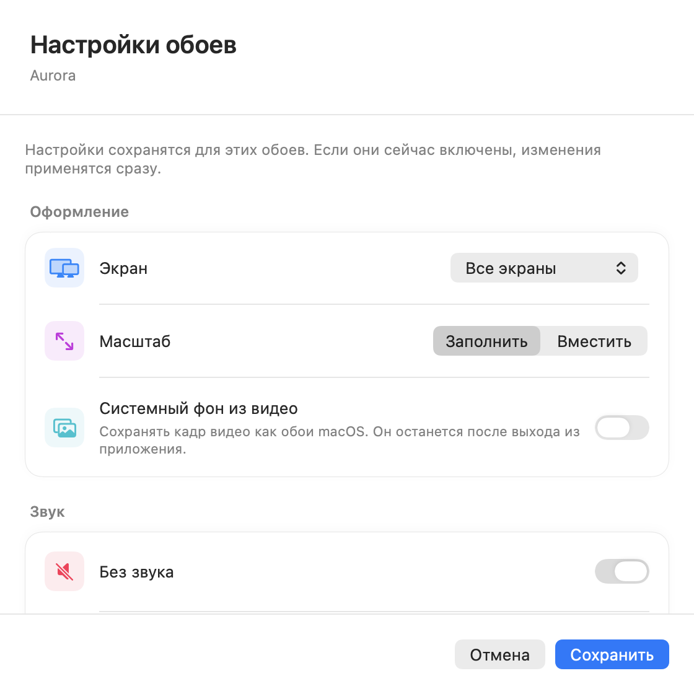

<div align="center">
  
  <h1>MyWallpaper</h1>
  <p><strong>Русский</strong> | <a href="README.en.md">English</a></p>
  <p><strong>Любимое видео — на рабочем столе Mac.</strong></p>
  <p>Живые обои без подписки и водяных знаков.<br>Нативное приложение на Swift и SwiftUI.</p>
  <p><strong>macOS 13+</strong> · Apple Silicon и Intel · Светлая и тёмная темы</p>
  <p>
    <a href="#установка">Установка</a> ·
    <a href="#возможности">Возможности</a> ·
    <a href="#первый-запуск">Первый запуск</a> ·
    <a href="#библиотека-обоев">Коллекция обоев</a> ·
    <a href="#видеозаставка-экспериментально">Заставка</a> ·
    <a href="#обновления">Обновления</a> ·
    <a href="#для-разработчиков">Для разработчиков</a>
  </p>
</div>

<picture>
  <source media="(prefers-color-scheme: dark)" srcset="docs/images/wallpaper-ru-dark.png">
  
</picture>

## Возможности

- **Твоё видео на рабочем столе.** Локальные MP4, MOV и другие форматы, поддерживаемые macOS, с непрерывным повтором.
- **Коллекция обоев.** Карточки с миниатюрами, своими названиями и сохранёнными настройками: добавляй видео, переключайся между вариантами, переименовывай и удаляй.
- **Забота о заряде.** По умолчанию от сети обои живые, от батареи — статичные. Оба режима настраиваются.
- **Умная пауза.** Если рабочий стол закрыт окнами, видео приостанавливается отдельно на каждом мониторе.
- **Всегда под рукой.** Управление из строки меню, восстановление выбранных обоев и автозапуск при входе.
- **Несколько экранов.** Обои на всех мониторах или только на основном; масштаб «Заполнить» или «Вместить».
- **Системный фон из видео.** По желанию сохраняй кадр как обычные обои macOS: он останется после остановки видео и выхода из приложения.
- **Новые версии рядом.** Проверка обновлений с GitHub, уведомление в приложении и загрузка DMG через браузер.
- **Библиотека видеозаставок.** Сохраняй варианты с понятными названиями, переименовывай, удаляй и выбирай заставку для установки в macOS. Пока экспериментально.
- **Обои и заставка вместе.** По желанию синхронизируй видео, масштаб и режимы питания через отдельную заставку MyWallpaper — Sync.

## Установка

**Нужны macOS Ventura 13 или новее и Mac с Apple Silicon либо Intel.** Универсальный DMG содержит обе архитектуры; Xcode и Swift для установки не нужны.

1. Скачай `.dmg` из [GitHub Releases](https://github.com/Illarioniche/MyWallpaper/releases).
2. Открой образ и перетащи **MyWallpaper.app → Applications («Программы»)**.
3. Извлеки образ и запусти **MyWallpaper** из папки «Программы».
4. В разделе **«Обои»** нажми **«Добавить видео»** или перетащи MP4/MOV в окно приложения.

> **При первом открытии.** Текущая сборка имеет локальную ad-hoc подпись и ещё не прошла нотарификацию Apple. Если macOS не может проверить разработчика или приложение, после попытки запуска открой **Системные настройки → Конфиденциальность и безопасность → «Все равно открыть»** и подтверди запуск, если доверяешь источнику загрузки. [Инструкция Apple](https://support.apple.com/ru-ru/102445).

## Первый запуск

1. В **«Обои → Мои обои»** добавь видео и настрой его через меню **«⋯ → Настроить»** на карточке.
2. В **«Питание»** оставь экономные настройки по умолчанию или выбери собственный режим для сети и батареи.
3. В **«Основные»** при желании включи запуск при входе в macOS. Делай это уже из установленной копии в «Программах».
4. В **«Обновления»** проверь версию приложения и настрой автоматическую проверку новых выпусков.

В **«Основные → Язык приложения»** доступны **Системный**, **Русский** и **English**. Выбор сохраняется и применяется сразу, без перезапуска. Системный режим выбирает первый поддерживаемый язык из списка предпочитаемых языков macOS; если подходящего нет, используется английский.

В **«Обои → Настроить → Звук»** настрой громкость от **0 до 100%**. Переключатель **«Без звука»** работает независимо: он временно отключает звук, сохраняя выбранную громкость. Значение **0%** тоже даёт тишину, даже когда переключатель выключен.

В **«Обои → Настроить → Оформление»** можно включить **«Системный фон из видео»**; по умолчанию эта настройка выключена. Приложение сохраняет кадр выбранного видео как статичные обои macOS и обновляет его при смене видео, масштаба, выбранных экранов или состава подключённых мониторов. Кадр применяется к текущему рабочему столу на выбранных экранах; macOS при этом может выключить «Показывать на всех пространствах Spaces». При желании снова включи этот параметр вручную в системных настройках обоев. Автоматическое применение ко всем Spaces и отображение кадра на экране блокировки не гарантируются. Анимацию продолжает воспроизводить MyWallpaper. Выключение настройки прекращает последующие обновления и оставляет последний сохранённый кадр.

Закрытие окна не выключает обои — приложение остаётся в строке меню. **Пауза** сохраняет текущий кадр; **«Выключить»** останавливает видео и показывает обычные обои macOS. Если системный фон был сохранён из видео, этот кадр остаётся после остановки и выхода из приложения.

## Библиотека обоев

В разделе **«Обои»** находится коллекция **«Мои обои»**. При добавлении видео приложение сохраняет свою копию и миниатюру: выбирать папку или управлять внутренними файлами не нужно. Исходный файл остаётся на месте; сохранённые обои доступны после перезапуска, даже если оригинал позже перемещён.

- **«Применить»** включает выбранное видео вместе с сохранёнными настройками. Карточка показывает, какой вариант выбран сейчас.
- **«⋯ → Настроить»** открывает настройки этой записи: экран, масштаб, звук и громкость, анимация от сети и батареи, пауза при закрытом рабочем столе и энергосбережении, синхронизация системного фона. **«Сохранить»** обновляет запись; если она выбрана сейчас, изменения сразу применяются. Настройка другого варианта не переключает текущие обои.
- **«⋯ → Переименовать»** меняет название карточки. **«Удалить»** после подтверждения убирает запись и её внутреннюю копию видео. Исходное видео не удаляется. Если удалить выбранные обои, воспроизведение остановится и эта запись больше не будет восстанавливаться при запуске. Ранее сохранённый системный кадр останется.

У карточки, панели текущих обоев и команды в строке меню один редактор **«Настроить»**. Он показывает текущие значения активных обоев, а для другого видео — его сохранённые настройки. **«Сохранить»** записывает изменения; **«Отмена»** оставляет всё как было. Отключение звука через быстрые команды тоже запоминается между запусками приложения.

<picture>
  <source media="(prefers-color-scheme: dark)" srcset="docs/images/wallpaper-editor-ru-dark.png">
  
</picture>

*Оформление, звук и питание выбранных обоев — в одном редакторе.*

Раздел **«Питание»** задаёт общие правила: сеть, батарея, энергосбережение и пауза при скрытом рабочем столе. Новые обои следуют этим правилам. Чтобы задать исключение, в редакторе конкретных обоев выключи **«Использовать общие правила»** и выбери свои режимы. Переключение карточек не меняет общие правила.

<picture>
  <source media="(prefers-color-scheme: dark)" srcset="docs/images/power-ru-dark.png">
  
</picture>

*Общие правила задаются один раз в разделе «Питание».*

<picture>
  <source media="(prefers-color-scheme: dark)" srcset="docs/images/wallpaper-power-exception-ru-dark.png">
  
</picture>

*При необходимости у конкретного видео могут быть свои правила.*

При обновлении прежние настройки питания становятся общими правилами, а сохранённые режимы существующих карточек остаются индивидуальными исключениями. Текущие настройки активных обоев, которые раньше не были записаны в карточку, также восстанавливаются: их можно сохранить через единый редактор. Исходные видео и сохранённые варианты не перезаписываются автоматически.

После обновления ранее выбранное видео продолжает работать как раньше: приложение не копирует его автоматически. Нажми **«Сохранить текущие обои»**, чтобы добавить его в коллекцию вместе с текущими настройками.

## Видеозаставка (экспериментально)

В разделе **«Заставка»** находится библиотека **«Мои заставки»**: сохранённые варианты с миниатюрами и названиями. Над ней можно включить синхронизацию с обоями.

1. В форме **«Новая заставка»** задай понятное название и нажми **«Выбрать видео»** или **«Из текущих обоев»**, чтобы взять уже выбранный файл.
2. Выбери масштаб и режимы анимации для сети и батареи. Это отдельные настройки заставки: по умолчанию от сети видео движется, на батарее и в режиме энергосбережения показывается неподвижный кадр.
3. Нажми **«Сохранить в библиотеку»**. Приложение само сохранит заставку вместе с копией видео — выбирать папку или управлять файлами не нужно.
4. Найди нужный вариант в **«Мои заставки»** и нажми **«Установить…»**. Подтверди установку в macOS. Разные заставки можно установить одновременно; при переустановке той же заставки подтверди замену её предыдущей копии.
5. Нажми **«Открыть настройки заставки»**, выбери установленную заставку по её названию и проверь предпросмотр. В macOS 26 и новее открой **«Обои» → «Заставка…»** и выбери **«Настроить»** в строке **«Использовать заставку»**. Прокрути список **внутри диалога** вниз до раздела **«Другое»** и при необходимости нажми **«Показать все»**. В macOS 14–15 открой **«Заставка» → «Другое»** и при необходимости разверни весь список; в macOS 13 найди заставку в списке миниатюр раздела **«Заставка»**. [Инструкция Apple](https://support.apple.com/guide/mac-help/mchl4b68853d/mac).

Через меню записи можно переименовать или удалить сохранённый вариант. Удаление требует подтверждения и убирает только запись библиотеки с её копией видео. **Исходное видео и уже установленная в macOS заставка не удаляются.** Переименование сразу меняет название в библиотеке; чтобы обновить его в macOS, установи эту заставку ещё раз.

Установленная заставка работает независимо от MyWallpaper: приложение можно закрыть. Она **всегда без звука**, независимо от громкости видеообоев. Кнопка **«Из текущих обоев»** берёт выбранное видео один раз; дальнейшие изменения обоев не меняют сохранённые заставки. Чтобы использовать другое видео или настройки, сохрани новый вариант и установи его из библиотеки.

Ранее созданные записи библиотеки сохраняются. Для их обновления достаточно снова нажать **«Установить…»**: приложение подготовит заставку из сохранённого видео и текущей версии встроенного проигрывателя. Заново создавать запись или выбирать исходный файл не нужно.

На macOS 26.7.1 проверено обнаружение двух независимо установленных заставок: после повторного открытия системных настроек системный каталог вернул обе записи с их пользовательскими названиями. Их наличие в системном выборе заставки также подтверждено. **Если новая заставка не появилась, закрой и снова открой системные настройки.**

**Это экспериментальная функция.** Предпросмотр в системных настройках и работа на настоящем экране блокировки ещё требуют проверки; поведение зависит от версии macOS и её поддержки сторонних заставок. Сообщение об открытии установки не подтверждает её завершение: проверь выбранную заставку в системных настройках. Показ видео за полем ввода пароля не поддерживается. Экран входа и экран разблокировки FileVault не изменяются. Установка и выбор заставки остаются за пользователем; параметры блокировки приложение не меняет.

### Синхронизация с обоями

1. Выбери обои из видео **MP4 или MOV** и открой **«Заставка → Обои и заставка вместе»**.
2. Включи **«Синхронизировать с обоями»**. Приложение подготовит отдельную копию выбранного видео с текущим масштабом и режимами питания.
3. Нажми **«Установить MyWallpaper — Sync…»** и подтверди установку в macOS. Затем выбери **MyWallpaper — Sync** в системных настройках заставки. В macOS 26 путь: **«Обои → Заставка… → Использовать заставку → Настроить → Другое»**; при необходимости нажми **«Показать все»**.

После подтверждённой установки блок настройки сворачивается в статус **«Заставка установлена»**. В меню **⋯** остаются **«Переустановить…»**, переход к настройкам macOS и инструкция. Если удалить заставку из macOS, при возвращении в приложение снова появится кнопка установки. Статус подтверждает наличие заставки, а выбрать её для показа нужно в системных настройках.

Достаточно установить и выбрать эту заставку один раз. После смены обоев, масштаба или режимов питания MyWallpaper обновит сохранённые данные, которые заставка прочитает при следующем запуске. Обычные варианты из **«Мои заставки»** остаются независимыми; выбор одного из них в macOS не включает синхронизацию автоматически.

Заставка всегда без звука. Ручная пауза обоев, перекрытие рабочего стола окнами и выбор основного монитора не переносятся на неё: экранами заставки управляет macOS. Выключение синхронизации, остановка обоев, выход из приложения и удаление обоев из библиотеки оставляют последнее сохранённое видео доступным для заставки. Синхронизация по умолчанию выключена.

**Режим экспериментальный:** работа связанной заставки в предпросмотре системных настроек и на экране блокировки ещё требует проверки. Открытый диалог установки не означает, что macOS завершила установку или выбрала заставку; эти шаги нужно подтвердить самостоятельно.

## Обновления

MyWallpaper проверяет последний стабильный выпуск в публичном [репозитории GitHub](https://github.com/Illarioniche/MyWallpaper/releases/latest). Автоматическая проверка включена по умолчанию: приложение проверяет, пора ли обратиться к GitHub, при запуске и раз в час во время работы, а сам запрос выполняет не чаще раза в 24 часа. Её можно отключить в разделе **«Обновления»**; ручная кнопка **«Проверить обновления»** остаётся доступна.

Когда найдена новая версия, в приложении появляется баннер, а у значка в строке меню — отметка. Системные уведомления и разрешение на них не используются. В разделе **«Обновления»** доступны страница выпуска, а при наличии опубликованных файлов — загрузка универсального DMG и ссылка на SHA-256. Загрузка открывается в браузере; приложение не скачивает и не устанавливает новую версию самостоятельно. Если GitHub недоступен или проверка завершилась ошибкой, обои продолжают работать, а проверку можно повторить вручную.

Чтобы обновиться:

1. Скачай DMG и заверши MyWallpaper через меню приложения.
2. Открой образ и перетащи **MyWallpaper.app** в **Applications**, подтвердив замену предыдущей версии.
3. Извлеки образ и запусти приложение из **«Программ»**.

При замене приложения настройки и выбранное видео сохраняются; исходный видеофайл не перемещается и не удаляется. Проверка SHA-256 описана [ниже](#сборка-dmg).

<details>
<summary><strong>Не вижу значок в строке меню</strong></summary>

Если в твоей версии macOS есть раздел «Строка меню», проверь в нём разрешение для MyWallpaper. На MacBook с вырезом значок может скрыться из-за нехватки места: удерживая **⌘ Command**, перетащи его ближе к часам, пока он виден, либо освободи место среди других значков. Повторное открытие MyWallpaper из «Программ» также возвращает окно управления.

</details>

<details>
<summary><strong>Не включается запуск при входе</strong></summary>

Сначала заверши MyWallpaper, перенеси приложение в **/Applications («Программы»)** и открой установленную копию. Не включай автозапуск у копии, запущенной прямо из DMG. macOS также может запускать скачанное приложение из временного изолированного расположения — App Translocation; для него и для диска только для чтения приложение показывает подсказку по установке.

Вернись в **«Основные»** и повтори включение автозапуска. Состояние повторно считывается из macOS: отсутствие регистрации само по себе не блокирует новую попытку. Если требуется подтверждение, открой системные настройки из приложения. Если регистрация по-прежнему не удаётся, перейди в **Системные настройки → Основные → Объекты входа и расширения**, нажми **«+»** под списком **«Открывать при входе»** и выбери установленный **MyWallpaper.app**. Название раздела может различаться в разных версиях macOS. [Инструкция Apple](https://support.apple.com/en-hk/guide/mac-help/-mh15189/mac).

После ручного добавления также включи **«Восстанавливать обои при запуске»** в MyWallpaper, чтобы при входе возвращалось выбранное видео.

Автозапуск использует системный Service Management. Текущая сборка подписана ad-hoc и не нотарифицирована; её регистрацию и запуск при входе нельзя гарантировать на каждой версии и конфигурации macOS.

</details>

---

## Для разработчиков

Внешних зависимостей нет. Ниже — сборка, упаковка релиза, проверки и детали работы приложения.

### Сборка из исходников

Для сборки нужны Swift 6 или новее и совместимая версия Xcode либо Apple Command Line Tools. Требования к macOS зависят от выбранных инструментов; macOS 13 — минимум для запуска готового приложения. Установить инструменты Apple и проверить версию компилятора:

```sh
xcode-select --install
swift --version
```

В папке проекта:

```sh
./scripts/build-app.sh
open dist/MyWallpaper.app
```

По умолчанию собирается архитектура текущего Mac. Для универсального приложения:

```sh
./scripts/build-app.sh --universal
```

Скрипт собирает arm64 и x86_64 отдельно, объединяет их через `lipo`, добавляет иконки и шаблон заставки в `Contents/PlugIns/MyWallpaper.saver`. Вложенная заставка подписывается первой, затем итоговый `.app` получает локальную ad-hoc подпись. Для локальной сборки не нужны платная учётная запись Apple Developer и `sudo`. Проект можно открыть в Xcode через `Package.swift`.

### Сборка шаблона заставки

```sh
./scripts/build-screensaver.sh
./scripts/build-screensaver.sh --universal
```

Первая команда собирает архитектуру текущего Mac, вторая — arm64 и x86_64. Результат — `.build/MyWallpaper.saver`, самостоятельный Mach-O bundle с `ScreenSaverView` из [Screen Saver framework](https://developer.apple.com/documentation/screensaver). Версия берётся из `Resources/Info.plist`; подпись и архитектуры проверяются при сборке. Шаблон не содержит видео и предназначен для экспорта из приложения: без добавленных ресурсов он показывает статичный фон с подсказкой. Скрипт ничего не устанавливает, не открывает системные настройки и не запускает заставку.

Библиотека приложения хранится в `~/Library/Application Support/MyWallpaper/ScreenSavers`. Каждой записи соответствует каталог с UUID и собственными метаданными. Перед установкой приложение готовит новый подписанный пакет из сохранённых ресурсов и текущего runtime. UUID задаёт стабильные уникальные bundle identifier, имя класса и имя установочного файла `MyWallpaper-UUID.saver`, а пользовательское название записывается в `CFBundleName` и `CFBundleDisplayName`. Ресурсы включают стандартные `thumbnail.png` и `thumbnail@2x.png` для системного списка. Существующая запись библиотеки при подготовке установки не изменяется. Удаление записи освобождает её внутреннее хранилище, не затрагивая отдельно установленную системную копию.

### Сборка DMG

```sh
./scripts/build-dmg.sh
```

Команда собирает универсальное приложение и создаёт сжатый образ для установки перетаскиванием:

```text
dist/
├── MyWallpaper.app
├── MyWallpaper-0.9.0-universal.dmg
└── MyWallpaper-0.9.0-universal.dmg.sha256
```

Внутри образа находятся приложение, ссылка на папку «Программы» и краткая инструкция. Версия берётся из `Info.plist`, архитектура — из готового исполняемого файла. Для упаковки уже собранного приложения без повторной компиляции:

```sh
./scripts/build-dmg.sh --skip-build
```

Имя такого образа отражает реальные архитектуры: `universal`, `arm64` или `x86_64`. Скрипт проверяет подпись приложения, целостность DMG и содержимое смонтированного образа. Файлы из `dist/` не добавляются в Git: для релиза приложи `.dmg` и `.sha256` к версии в GitHub Releases. Скрипты сами не создают тег и не публикуют релиз.

Проверка скачанного образа из каталога с обоими файлами:

```sh
shasum -a 256 -c MyWallpaper-0.9.0-universal.dmg.sha256
```

Universal-сборка включает Intel, но текущая проверка запуска выполнялась на Apple Silicon. Для распространения с подтверждённым разработчиком отдельно потребуются Developer ID и нотарификация Apple.

### Иконки и скриншоты

Иконки приложения, интерфейса и строки меню рисуются в `Sources/MyWallpaper/AppIconArtwork.swift`. Сборка создаёт полный набор размеров `.icns` из того же рисунка.

Скриншоты в обоих README используют собственный демонстрационный пейзаж **Aurora**, без пользовательских файлов. Для русского и английского интерфейса создаются светлые и тёмные варианты коллекции, единого редактора, общих правил питания и индивидуального исключения. Тема изображений в README выбирается автоматически. Их можно воспроизвести:

```sh
./scripts/render-readme.sh
```

Демонстрационный MP4 и промежуточные изображения сохраняются в `.build/readme/`; видео не входит в приложение или DMG. Рендер использует изолированные настройки, не показывает окна и не включает обои. После визуальной проверки обнови изображения в документации:

```sh
./scripts/render-readme.sh --copy-images
```

### Подробное использование

1. Нажмите «Выбрать видео» или перетащите MP4/MOV в окно приложения.
2. В основном окне выберите раздел слева: **Обои**, **Основные**, **Питание**, **Заставка** или **Обновления**. Здесь находятся коллекция и единый редактор обоев; автозапуск и язык; общие правила питания; библиотека системных заставок; проверка и загрузка новых версий.
3. Управляйте воспроизведением через окно или значок в строке меню. Закрытие окна оставляет обои включёнными.
4. Пауза останавливает видео на текущем кадре. Остановка обоев или выход возвращает обычный рабочий стол.

Видео зацикливается; звук по умолчанию выключен. Громкость видео настраивается в диапазоне 0–100% отдельно от отключения звука; обе настройки сохраняются. Приложение запоминает выбранный файл и язык интерфейса. Если файл удалён или стал недоступен, его потребуется выбрать снова. Поддержка конкретного кодека определяется AVFoundation в установленной macOS.

При сне экрана и неактивном сеансе воспроизведение приостанавливается. В настройках доступна автоматическая пауза в режиме энергосбережения.

### Автозапуск и экономия энергии

В **Питание** по умолчанию включены **Живые обои от сети** и выключены **Живые обои от батареи**. MacBook с подключённым блоком питания (в том числе при полностью заряженной батарее), Mac mini и Mac Studio используют настройку питания от сети. При переходе на батарею видео замирает на текущем кадре, при подключении питания — продолжается. Обе настройки можно менять независимо; выбор запоминается и действует при следующих переключениях и запусках.

Кнопка **Оживить сейчас** временно разрешает анимацию: до смены источника питания, выбора других обоев или выключения. Она не изменяет сохранённые правила и режим связанной заставки. Ручная пауза сохраняется при подключении и отключении зарядки, а сон, скрытый рабочий стол и системное энергосбережение остаются отдельными причинами приостановки. При запуске сразу в статичном режиме показывается первый кадр выбранного видео, без кратковременного воспроизведения. Если macOS не сообщила источник питания, применяется сохранённая настройка для сети.

В строке меню доступны состояние обоев, воспроизведение, выключение, отключение звука и переходы к единому редактору и настройкам приложения. Команда **Открыть настройки…** и `⌘,` открывают раздел **Основные**.

В разделе **Основные → Запускать при входе в macOS** можно включить системный автозапуск. При включении также активируется восстановление выбранного видео. После входа приложение запускается в строке меню, без открытия панели управления. Ручная пауза и команда «Выключить обои» сохраняются при следующем запуске.

Если macOS ожидает подтверждения, рядом с автозапуском отображается промежуточное состояние и переход в системные настройки. Состояние перечитывается из системы при открытии настроек, поэтому внешние изменения тоже учитываются. Отсутствующую регистрацию можно создать повторной попыткой; ошибка не заменяет фактический статус системы. Для постоянного использования сначала перенесите `.app` в «Программы», откройте эту копию и включите автозапуск в ней. Если регистрация не удаётся, используйте инструкцию **«Не включается запуск при входе»** выше.

**Пауза, когда рабочий стол скрыт** включена по умолчанию. Она действует отдельно для каждого монитора: полностью закрытые окнами обои замирают на последнем кадре, а при появлении рабочего стола продолжаются. Небольшие зазоры по краям экрана учитываются с допуском 16 пунктов macOS, чтобы скругления окон не мешали паузе. Если скрыта только часть мониторов, статус показывает число воспроизводящих экранов, например **Воспроизведение: 1 из 2 экранов**. Когда скрыты все выбранные экраны, отображается **Пауза: рабочий стол скрыт**. Ручная пауза, сон и режим энергосбережения имеют приоритет над автоматическим возобновлением. Настройку можно отключить в разделе **Питание** или в индивидуальных правилах обоев. Проверяются границы окон, а не прозрачность каждого пикселя: развёрнутое полупрозрачное окно тоже может включить паузу.

### Проверки

Модульные тесты на Swift Testing проверяют сохранение настроек, выбор языка и перевод строк, независимость громкости и отключения звука, источники питания и их переключения, сочетания причин паузы, управление автозапуском через подставной сервис и проверку обновлений через подставной сетевой транспорт. Реальные системные элементы входа и питание устройства тестами не изменяются; тесты обновлений не обращаются к GitHub:

```sh
./scripts/test.sh
```

Проверка перекрытия настоящими окнами macOS без загрузки видео и изменения настроек:

```sh
./scripts/test-coverage.sh --run
```

Она на несколько секунд открывает небольшие тестовые окна в области 360 × 240, проверяет обычные окна со скруглениями, частичное и совместное перекрытие, отдельный процесс и остановку фоновых проверок. Все тестовые окна закрываются автоматически; окна других приложений не меняются. `--build-only` только компилирует проверку.

Интеграционная проверка требует открытого графического сеанса macOS и пути к локальному видео. Она временно показывает его на рабочем столе, проверяет работу приложения и затем убирает тестовые обои. Настройки проверки изолированы от обычного приложения.

```sh
./scripts/smoke-test.sh "/absolute/path/video.mp4"
```

Сценарий проверяет восстановление видео после нового запуска, ручную паузу, перекрытие рабочего стола настоящими тестовыми окнами и сохраняет изображения собственного окна в `.build/verification/empty.png` и `loaded.png`. Для проверки видимости оставьте часть рабочего стола открытой; окна других приложений тест не закрывает. Чтобы только скомпилировать проверку без запуска окон, используйте `./scripts/smoke-test.sh --build-only`.

Отдельная интеграционная проверка библиотеки обоев проверяет импорт, применение сохранённых вариантов с их настройками, восстановление и удаление:

```sh
./scripts/test-wallpaper-library.sh "/path/to/video.mp4"
```

Она требует графического сеанса macOS и временно показывает видео без звука в собственных тестовых окнах рабочего стола. Хранилище и настройки изолированы от приложения; системный фон, существующие коллекции и исходное видео не изменяются. Тестовые окна закрываются после проверки. Для компиляции без запуска используй `./scripts/test-wallpaper-library.sh --build-only`.

Связанную заставку можно проверить в скрытых тестовых окнах:

```sh
./scripts/build-screensaver.sh
./scripts/test-screensaver-sync.sh "/path/to/video.mp4"
```

Проверка создаёт временные данные и установщик, переключает видео и настройки, проверяет восстановление после недоступных данных и совместимость с обычной заставкой. Установки в macOS и блокировки экрана нет; эта проверка не заменяет предпросмотр в системных настройках.

Для проверки интерфейса без показа окон и включения обоев:

```sh
./scripts/render-ui.sh "/absolute/path/video.mp4"
```

Путь к видео необязателен. Переданное демонстрационное или локальное видео используется для миниатюр и, при наличии собранного шаблона заставки, для временной библиотеки из двух записей в `.build/verification/ScreenSaverPreview-UUID`. Пакеты получают локальную ad-hoc подпись через `codesign`; временная библиотека удаляется при завершении рендера. Скрипт сохраняет разделы приложения, список заставок, пустую библиотеку и форму создания в светлой и тёмной темах, включая компактные варианты. Для обновлений отдельно воспроизводятся доступная версия, проверка, отсутствие сети и актуальная версия; баннер сохранён в отдельных `ui-update-banner-wallpaper-*.png`. Стандартные скриншоты для README не содержат уведомлений о вымышленных выпусках. Дополнительно проверяются подсказки автозапуска при отсутствующей регистрации, диске только для чтения и ошибке регистрации. Ответы GitHub, сервис автозапуска и установщик заставок подставные: реальных сетевых запросов, изменений объектов входа, установки заставок и открытия системных настроек нет. Изображения находятся в `.build/verification/ui-*.png` (компактные варианты — с суффиксом `-compact`), с изолированными настройками и без снимков рабочего стола.

### Как это устроено

Отдельные окна AppKit расположены на уровне рабочего стола под значками Finder и пропускают нажатия мыши. На каждом экране `AVQueuePlayer` с `AVPlayerLooper` воспроизводит видео. По умолчанию системное изображение обоев остаётся прежним, а приложение показывает видео поверх него. Если включить «Системный фон из видео», приложение дополнительно сохраняет кадр как статичные обои macOS через `NSWorkspace.setDesktopImageURL`; этот кадр остаётся после выхода из MyWallpaper.

Автозапуск использует [SMAppService.mainApp](https://developer.apple.com/documentation/servicemanagement/smappservice). Видимость отслеживается через [уведомления AppKit о перекрытии окон](https://developer.apple.com/documentation/appkit/nswindow/didchangeocclusionstatenotification) и дополнительно проверяется по прямоугольникам окон раз в секунду. Дополнительная проверка работает только при включённой паузе скрытого рабочего стола и разрешённой анимации. Она читает геометрию окон; запись экрана, доступ к их содержимому и разрешение «Универсальный доступ» не требуются.

Источник питания определяется через IOKit и обновляется по системным уведомлениям, без таймера. Для статичного запуска один кадр извлекается через `AVAssetImageGenerator` и показывается до готовности видеослоя; при паузе уже запущенного видео сохраняется текущий кадр.

`AppLocalizer` выбирает русский или английский каталог `Resources/*/Localizable.strings` по настройке приложения. Смена языка обновляет интерфейс и меню без изменения системных настроек macOS. Громкость и отключение звука хранятся отдельно и применяются к видеоплеерам; отключение звука не сбрасывает выбранный уровень.

`UpdateController` запрашивает публичный GitHub API `GET /repos/Illarioniche/MyWallpaper/releases/latest` и сравнивает версию установленного приложения с последним стабильным выпуском. Предварительные и черновые выпуски не предлагаются. Контроллер хранит настройку автоматической проверки и время последней попытки, чтобы соблюдать суточный интервал, а также время последней успешной проверки. Если повторная проверка не удалась, уже найденная новая версия остаётся доступна. Ссылки на DMG, страницу выпуска и SHA-256 открываются в браузере. Установка обновлений и изменение файлов приложения в этот механизм не входят.

Проект находится на стадии MVP. Готовый DMG использует локальную ad-hoc подпись. Отдельные видео для разных мониторов, редактор сцен и распространение с Developer ID/notarization пока не реализованы. Видеообои используют процессор/GPU; расход энергии зависит от разрешения, частоты кадров и числа экранов.
